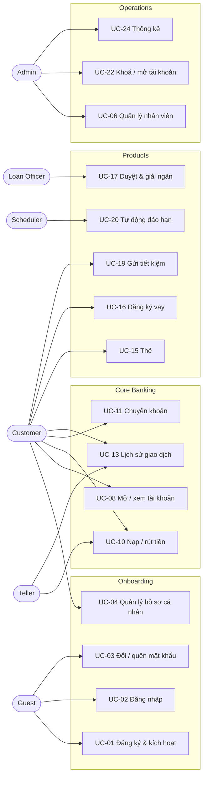

# SRS — Đặc tả yêu cầu phần mềm: Banking System

> **Loại tài liệu:** Software Requirements Specification (SRS). Trả lời câu hỏi *hệ thống phải làm gì*, không nói *làm thế nào* (phần đó ở [`../system_design.md`](../system_design.md)).
> **Phiên bản:** 2.0 (2026-11-02). Thay bản 1.0 cũ (FastAPI / C++ / PostgreSQL), stack đó đã bỏ.

## Mục lục

- [1. Giới thiệu](#1-giới-thiệu)
- [2. Mô tả tổng quan](#2-mô-tả-tổng-quan)
- [3. Use case](#3-use-case)
- [4. Yêu cầu chức năng](#4-yêu-cầu-chức-năng)
- [5. Quy tắc nghiệp vụ](#5-quy-tắc-nghiệp-vụ)
- [6. Yêu cầu phi chức năng](#6-yêu-cầu-phi-chức-năng)
- [7. Ngoài phạm vi & hướng mở rộng](#7-ngoài-phạm-vi--hướng-mở-rộng)

---

## 1. Giới thiệu

### 1.1 Mục đích

Mô tả yêu cầu của hệ thống ngân hàng số Banking System. Dùng làm căn cứ cho thiết kế, lập trình, kiểm thử và bảo trì.

### 1.2 Phạm vi

Banking System là ứng dụng web cho một ngân hàng bán lẻ quy mô nhỏ (đồ án cá nhân / portfolio):

- **Khách hàng** tự đăng ký, mở tài khoản, chuyển tiền, vay vốn, gửi tiết kiệm và xem lịch sử giao dịch trực tuyến.
- **Nhân viên** xử lý nghiệp vụ tại quầy (nạp tiền, tra cứu khách hàng) và duyệt khoản vay.
- **Quản trị viên** quản lý nhân sự, chi nhánh, khoá/mở tài khoản và xem thống kê.

Chỉ hỗ trợ giao dịch **nội bộ trong ngân hàng**, không kết nối liên ngân hàng hay mạng thẻ thật.

### 1.3 Người đọc

| Người đọc | Đọc phần nào |
|---|---|
| Lập trình viên | Toàn bộ, đặc biệt §4–§5 |
| Tester | §3 (luồng use case), §5 (quy tắc để viết test case) |
| Người review portfolio / nhà tuyển dụng | §1–§3 |

### 1.4 Thuật ngữ

| Thuật ngữ | Nghĩa |
|---|---|
| Tài khoản đăng nhập (Account) | Thông tin đăng nhập: username, mật khẩu, vai trò. Một người có đúng 1 tài khoản đăng nhập. |
| Tài khoản ngân hàng (Banking Account) | Nơi giữ tiền, có số tài khoản 20 chữ số. Một khách hàng có thể có nhiều tài khoản ngân hàng. |
| Số dư (balance) / Số dư khả dụng (available balance) | Số dư là tổng tiền trong tài khoản; số dư khả dụng là phần được phép tiêu. |
| CIF | Customer Information File, mã định danh khách hàng (`CIF0000001`). |
| OTP | Mã xác thực 6 chữ số dùng một lần, có thời hạn. |
| Người thụ hưởng (Beneficiary) | Người nhận tiền được khách hàng lưu sẵn để chuyển nhanh. |
| Đáo hạn / tất toán | Sổ tiết kiệm hết kỳ hạn / khách hàng rút tiền và đóng sổ. |

---

## 2. Mô tả tổng quan

### 2.1 Bối cảnh sản phẩm

Hệ thống gồm 3 phần (chi tiết ở [`../system_design.md`](../system_design.md)):

| Phần | Công nghệ |
|---|---|
| Giao diện web | React + TypeScript (tạm hoãn, làm sau backend) |
| API | ASP.NET Core Web API (C#, .NET 10) |
| Cơ sở dữ liệu | SQL Server; nghiệp vụ cốt lõi nằm trong stored procedure |

### 2.2 Tác nhân (Actor)

| Actor | Mô tả | Vai trò hệ thống |
|---|---|---|
| Khách vãng lai (Guest) | Người chưa đăng nhập | — |
| Khách hàng (Customer) | Người có tài khoản ngân hàng | `Customer` |
| Giao dịch viên (Teller) | Nhân viên tại quầy | `Employee`, chức vụ `Teller` |
| Cán bộ tín dụng (Loan Officer) | Nhân viên duyệt khoản vay | `Employee`, chức vụ `Loan Officer` |
| Nhân viên khác | `Manager`, `Customer Service`: tra cứu, hỗ trợ khách hàng | `Employee` |
| Quản trị viên (Admin) | Quản lý hệ thống | `Admin` |
| Hệ thống (Scheduler) | Tác vụ tự động chạy theo lịch | — |

### 2.3 Giả định & ràng buộc

- Ngân hàng hoạt động theo giờ Việt Nam (`Asia/Ho_Chi_Minh`).
- Mỗi tài khoản ngân hàng dùng một loại tiền (`VND`, `USD`, `EUR`, `GBP`, `JPY`), **không quy đổi ngoại tệ**.
- OTP ở môi trường dev được ghi vào log thay vì gửi email/SMS.
- Cơ sở dữ liệu và stored procedure đã có sẵn, được dựng lại bằng `database/deploy.ps1`.

---

## 3. Use case

### 3.1 Sơ đồ tổng quan

### 3.2 Danh mục use case

Cột **Milestone** khớp với lộ trình trong [`../../PLAN.md`](../../PLAN.md).

| ID | Use case | Actor chính | Milestone |
|---|---|---|---|
| UC-01 | Đăng ký & kích hoạt tài khoản | Guest | M1 |
| UC-02 | Đăng nhập | Guest | M1 |
| UC-03 | Đổi mật khẩu / quên mật khẩu | Customer, Employee, Admin / Guest | M1 |
| UC-04 | Quản lý hồ sơ cá nhân | Customer, Employee | M1 |
| UC-05 | Tra cứu khách hàng | Employee | M1 |
| UC-06 | Quản lý nhân viên (tạo tài khoản, chức vụ, trạng thái, chi nhánh) | Admin | M1 |
| UC-07 | Quản lý chi nhánh (Guest chỉ xem danh sách) | Admin | M0–M1 |
| UC-08 | Mở & xem tài khoản ngân hàng | Customer | M2 |
| UC-09 | Đóng băng / đóng tài khoản ngân hàng | Employee | M2 |
| UC-10 | Nạp tiền (tại quầy) / rút tiền | Teller / Customer | M2 |
| UC-11 | Chuyển khoản nội bộ | Customer | M2 |
| UC-12 | Thanh toán | Customer | M2 |
| UC-13 | Xem & tìm kiếm lịch sử giao dịch | Customer, Employee | M2 |
| UC-14 | Quản lý người thụ hưởng | Customer | M2 |
| UC-15 | Phát hành / khoá thẻ | Customer | M3 |
| UC-16 | Đăng ký khoản vay | Customer | M3 |
| UC-17 | Duyệt & giải ngân khoản vay | Loan Officer | M3 |
| UC-18 | Trả nợ vay & xem lịch trả góp | Customer | M3 |
| UC-19 | Gửi tiết kiệm & tất toán | Customer | M3 |
| UC-20 | Tự động đáo hạn sổ tiết kiệm | Scheduler | M3 |
| UC-21 | Nhận & đọc thông báo | Customer, Employee | M4 |
| UC-22 | Khoá / mở khoá tài khoản đăng nhập | Admin | M4 |
| UC-23 | Xem lịch sử đăng nhập | Customer, Admin | M4 |
| UC-24 | Xem thống kê | Admin | M4 |

### 3.3 Đặc tả các use case chính

#### UC-01 Đăng ký & kích hoạt tài khoản

| | |
|---|---|
| **Actor** | Guest |
| **Mục tiêu** | Tạo tài khoản đăng nhập và kích hoạt bằng OTP |
| **Tiền điều kiện** | Username / email / số điện thoại chưa được dùng |
| **Hậu điều kiện** | Tài khoản ở trạng thái `Active`, đăng nhập được |

**Luồng chính**
1. Guest nhập username, email, số điện thoại, mật khẩu.
2. Hệ thống kiểm tra dữ liệu, lưu tài khoản ở trạng thái `Pending` (mật khẩu chỉ lưu dạng hash).
3. Hệ thống sinh OTP mục đích `Register` và gửi cho Guest (dev: ghi log).
4. Guest nhập OTP.
5. Hệ thống xác thực OTP và chuyển tài khoản sang `Active`.

**Luồng thay thế**
- 2a. Username / email / số điện thoại đã tồn tại → báo lỗi, Guest nhập lại.
- 4a. OTP sai hoặc hết hạn → báo lỗi; Guest yêu cầu OTP mới (OTP cũ bị vô hiệu).

**Luồng ngoại lệ**
- Mất kết nối cơ sở dữ liệu → báo lỗi hệ thống, không tạo dữ liệu dở dang.

#### UC-02 Đăng nhập

| | |
|---|---|
| **Actor** | Guest |
| **Tiền điều kiện** | Tài khoản ở trạng thái `Active` |
| **Hậu điều kiện** | Guest nhận phiên đăng nhập (token) theo đúng vai trò; lượt đăng nhập được ghi vào lịch sử |

**Luồng chính**
1. Guest nhập username và mật khẩu.
2. Hệ thống so khớp mật khẩu với hash đã lưu.
3. Hệ thống ghi lịch sử đăng nhập thành công (IP, thiết bị) và cấp token có thời hạn.

**Luồng thay thế**
- 2a. Sai mật khẩu → ghi lịch sử đăng nhập thất bại, báo "sai thông tin đăng nhập" (không nói rõ sai username hay mật khẩu).
- 2b. Tài khoản `Pending` / `Locked` / `Disabled` → từ chối, báo trạng thái.

#### UC-11 Chuyển khoản nội bộ

| | |
|---|---|
| **Actor** | Customer |
| **Tiền điều kiện** | Đã đăng nhập; tài khoản nguồn thuộc sở hữu của khách hàng và đang `Active` |
| **Hậu điều kiện** | Tài khoản nguồn bị trừ (số tiền + phí), tài khoản đích được cộng; có bản ghi giao dịch `Successful`; khách hàng nhận thông báo |

**Luồng chính**
1. Customer chọn tài khoản nguồn, nhập tài khoản đích (hoặc chọn người thụ hưởng), số tiền, nội dung.
2. Hệ thống kiểm tra quyền sở hữu tài khoản nguồn.
3. Hệ thống trừ và cộng tiền trong **một giao dịch nguyên tử**, kiểm tra số dư khả dụng ngay trong lúc trừ.
4. Hệ thống lưu giao dịch, trả kết quả và gửi thông báo.

**Luồng thay thế**
- 2a. Tài khoản nguồn không thuộc khách hàng → từ chối (403).
- 3a. Không đủ số dư khả dụng → từ chối, không thay đổi số dư nào.
- 3b. Khác loại tiền giữa hai tài khoản → từ chối.

**Luồng ngoại lệ**
- Gửi thông báo thất bại → giao dịch **vẫn thành công**, lỗi chỉ được ghi log.

#### UC-16 / UC-17 Vòng đời khoản vay

| | |
|---|---|
| **Actor** | Customer (đăng ký, trả nợ), Loan Officer (duyệt, giải ngân) |
| **Hậu điều kiện** | Khoản vay đi đúng vòng đời trạng thái; tiền giải ngân vào tài khoản của khách hàng |

**Luồng chính**
1. Customer đăng ký vay: loại vay, số tiền, kỳ hạn (tháng), lãi suất năm → khoản vay `Pending`.
2. Loan Officer xem hàng chờ, duyệt → `Approved` (hoặc từ chối → `Rejected`, kết thúc).
3. Loan Officer giải ngân vào một tài khoản ngân hàng `Active` của khách hàng → `Disbursed`, tài khoản đó được cộng tiền.
4. Customer xem lịch trả góp và trả từng kỳ; trả hết → `Closed`.

**Luồng thay thế**
- 2a. Nhân viên không phải Loan Officer → không được duyệt.
- 3a. Giải ngân khoản vay chưa `Approved` → từ chối.

#### UC-19 / UC-20 Gửi tiết kiệm & đáo hạn

**Luồng chính**
1. Customer mở sổ tiết kiệm từ một tài khoản nguồn: số tiền gửi, kỳ hạn, lãi suất → tiền bị trừ khỏi tài khoản nguồn, sổ `Active`.
2. Đến ngày đáo hạn, Scheduler tự chuyển sổ sang `Matured`.
3. Customer tất toán → nhận gốc + lãi về tài khoản nguồn, sổ `Closed`.

**Luồng thay thế**
- 3a. Tất toán **trước hạn** → chỉ nhận lại tiền gốc.

---

## 4. Yêu cầu chức năng

| ID | Yêu cầu | UC |
|---|---|---|
| **Xác thực** | | |
| FR-01 | Guest đăng ký tài khoản bằng username, email, số điện thoại, mật khẩu | UC-01 |
| FR-02 | Hệ thống sinh và xác thực OTP theo mục đích (`Register`, `Login`, `Transaction`, `Verify Email`, `PasswordReset`) | UC-01, UC-03 |
| FR-03 | Guest đăng nhập bằng username + mật khẩu, nhận token có thời hạn | UC-02 |
| FR-04 | Đăng xuất: client huỷ token (token tự hết hạn sau TTL) | UC-02 |
| FR-05 | Người dùng đổi mật khẩu khi đã đăng nhập | UC-03 |
| FR-06 | Guest đặt lại mật khẩu qua OTP `PasswordReset` | UC-03 |
| FR-07 | Mọi lượt đăng nhập (thành công / thất bại) được ghi lịch sử kèm IP và thiết bị | UC-02, UC-23 |
| **Hồ sơ & tổ chức** | | |
| FR-08 | Customer tạo, xem, cập nhật hồ sơ của chính mình; đổi ảnh đại diện | UC-04 |
| FR-09 | Employee xem, cập nhật hồ sơ của chính mình | UC-04 |
| FR-10 | Employee tìm khách hàng theo CCCD / họ tên, xem tổng quan khách hàng | UC-05 |
| FR-11 | Admin tạo tài khoản nhân viên, đổi chức vụ, trạng thái, chi nhánh | UC-06 |
| FR-12 | Admin tạo, sửa, đóng chi nhánh; mọi người xem được danh sách chi nhánh đang hoạt động | UC-07 |
| **Tài khoản & giao dịch** | | |
| FR-13 | Customer mở tài khoản ngân hàng (loại + tiền tệ), xem danh sách và chi tiết tài khoản của mình | UC-08 |
| FR-14 | Employee đóng băng / mở băng / đóng tài khoản ngân hàng | UC-09 |
| FR-15 | Teller nạp tiền vào tài khoản; Customer rút tiền từ tài khoản của mình | UC-10 |
| FR-16 | Customer chuyển khoản nội bộ và thanh toán | UC-11, UC-12 |
| FR-17 | Xem, lọc (loại, trạng thái, khoảng ngày), phân trang lịch sử giao dịch | UC-13 |
| FR-18 | Customer lưu, sửa, xem người thụ hưởng và chuyển tiền tới người thụ hưởng | UC-14 |
| **Sản phẩm** | | |
| FR-19 | Customer phát hành thẻ (Debit / Credit) cho tài khoản của mình, xem và khoá thẻ | UC-15 |
| FR-20 | Customer đăng ký vay; Loan Officer duyệt / từ chối / giải ngân; Customer trả nợ | UC-16, UC-17, UC-18 |
| FR-21 | Customer xem lịch trả góp từng kỳ (gốc, lãi, dư nợ) | UC-18 |
| FR-22 | Customer mở sổ tiết kiệm, tất toán đúng hạn hoặc trước hạn | UC-19 |
| FR-23 | Hệ thống tự động đáo hạn sổ tiết kiệm hằng ngày | UC-20 |
| **Vận hành** | | |
| FR-24 | Hệ thống gửi thông báo khi giao dịch / giải ngân thành công; người dùng xem và đánh dấu đã đọc | UC-21 |
| FR-25 | Admin khoá / mở khoá / vô hiệu hoá tài khoản đăng nhập | UC-22 |
| FR-26 | Customer xem lịch sử đăng nhập của mình; Admin xem của mọi người | UC-23 |
| FR-27 | Admin xem thống kê khách hàng và chi nhánh | UC-24 |

---

## 5. Quy tắc nghiệp vụ

Các quy tắc dưới đây được **cơ sở dữ liệu (stored procedure) bảo đảm**. API không viết lại, chỉ cần không làm sai chúng. Định dạng dữ liệu chi tiết ở [`../api_contract.md`](../api_contract.md) §1.

| ID | Quy tắc |
|---|---|
| BR-01 | Tiền lưu 2 chữ số thập phân, làm tròn half-up. Không bao giờ dùng số thực dấu phẩy động cho tiền. |
| BR-02 | Không quy đổi ngoại tệ. Giao dịch giữa hai tài khoản khác loại tiền bị từ chối. |
| BR-03 | Số dư khả dụng **không bao giờ âm**. Kiểm tra số dư và trừ tiền phải diễn ra trong cùng một thao tác nguyên tử. |
| BR-04 | Chỉ tài khoản ngân hàng `Active` mới được trừ tiền. `Frozen` và `Closed` không giao dịch được. |
| BR-05 | Tài khoản đăng nhập: `Pending` → `Active` (sau OTP). `Locked` / `Disabled` không đăng nhập được. |
| BR-06 | OTP dùng một lần, có thời hạn; sinh OTP mới làm OTP cũ hết hạn. Mã OTP không bao giờ xuất hiện trong response API. |
| BR-07 | Mật khẩu chỉ lưu dạng hash có salt. Không trả `password_hash`, `cvv_hash`, `otp_code` ra ngoài. |
| BR-08 | Customer chỉ thao tác trên dữ liệu **của chính mình**. Nhân viên / Admin được quyền theo vai trò. |
| BR-09 | Khoản vay: `Pending` → `Approved` / `Rejected`; `Approved` → `Disbursed` → `Closed`. Chỉ Loan Officer được duyệt. |
| BR-10 | Tiền góp hằng tháng: `M = P·r·(1+r)^n / ((1+r)^n − 1)`, với `r` = lãi năm / 12 / 100; nếu `r = 0` thì `M = P / n`. Kỳ cuối gánh phần lẻ để dư nợ về 0. |
| BR-11 | Tiết kiệm tính lãi đơn: `lãi = tiền gửi · lãi suất/100 · số tháng/12`. Tất toán trước hạn chỉ nhận gốc. |
| BR-12 | Số thẻ hợp lệ theo Luhn, chỉ hiện đầy đủ **một lần** khi phát hành; mọi lần sau hiển thị dạng `400000******1234`. |
| BR-13 | Thông báo là best-effort: gửi thất bại không làm huỷ giao dịch đã thành công. |

---

## 6. Yêu cầu phi chức năng

| Nhóm | ID | Yêu cầu |
|---|---|---|
| Bảo mật | NFR-01 | Mật khẩu hash bằng PBKDF2 (`PasswordHasher` của ASP.NET Core Identity) |
| Bảo mật | NFR-02 | Xác thực bằng JWT, thời hạn 60 phút; phân quyền theo vai trò và quyền sở hữu dữ liệu |
| Bảo mật | NFR-03 | HTTPS khi triển khai; không commit secret (connection string, JWT secret) vào git |
| Bảo mật | NFR-04 | Che dữ liệu nhạy cảm (email, số điện thoại, CCCD, số tài khoản, số thẻ) trong response |
| Hiệu năng | NFR-05 | 95% request phản hồi dưới 2 giây với 100 người dùng đồng thời |
| Tin cậy | NFR-06 | Mọi giao dịch tiền nguyên tử (thành công trọn vẹn hoặc không thay đổi gì) và được lưu vết |
| Tin cậy | NFR-07 | Ghi log có cấu trúc cho đăng nhập, giao dịch tiền và lỗi |
| Bảo trì | NFR-08 | Code chia theo nghiệp vụ (feature folder), mỗi feature theo mẫu Controller → Service → Repository; dùng Dependency Injection |
| Bảo trì | NFR-09 | Mỗi feature có integration test cho luồng chính và luồng lỗi; logic tính toán thuần có unit test |
| Triển khai | NFR-10 | Chạy được toàn bộ (API + SQL Server) bằng một lệnh `docker compose up` |
| Dữ liệu | NFR-11 | SQL Server, schema chuẩn hoá; schema được dựng lại từ đầu bằng `database/deploy.ps1` |

---

## 7. Ngoài phạm vi & hướng mở rộng

**Không làm trong phiên bản này:**
- Chuyển tiền liên ngân hàng, quy đổi ngoại tệ, kết nối mạng thẻ thật.
- Ứng dụng mobile, đăng nhập bằng mạng xã hội, refresh token.

**Hướng mở rộng:**
- Thanh toán QR, xác thực đa yếu tố (MFA) cho mọi giao dịch.
- Thông báo thời gian thực qua WebSocket.
- Phát hiện gian lận dựa trên hành vi giao dịch.
