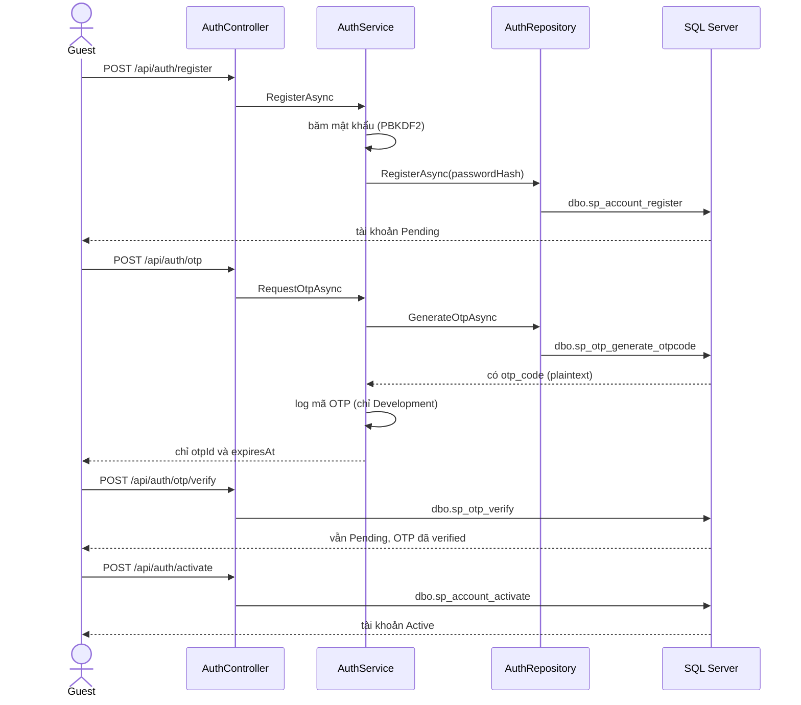

# 🎓 Bài học Task 3 — Đăng ký, OTP và kích hoạt tài khoản

> Tổng hợp những gì đã học khi làm **Task 3** (UC-01) từ đầu đến khi có test đầu tiên: kiến trúc, cú pháp C# mới, bảo mật, các lỗi đã gặp và cách đọc kết quả test.
> Cách học: đọc phần 1–2 để nắm bức tranh, phần 6 để nhớ **vì sao mỗi lỗi xảy ra**, rồi tự trả lời phần 10 mà không nhìn đáp án.

| Ký hiệu | Nghĩa |
|---|---|
| 🟢 | Đúng / nên làm / đã xong |
| 🔴 | Sai / lỗi / nguy hiểm |
| 🟡 | Cẩn thận / còn dang dở |
| 🔵 | Khái niệm cần nhớ |
| 🛡️ | Liên quan bảo mật |

## 📑 Mục lục

1. [Bức tranh tổng thể](#1--bức-tranh-tổng-thể)
2. [Bản đồ file và trách nhiệm từng tầng](#2--bản-đồ-file-và-trách-nhiệm-từng-tầng)
3. [Cách làm việc theo AGENTS.md](#3--cách-làm-việc-theo-agentsmd)
4. [Cú pháp và khái niệm mới](#4--cú-pháp-và-khái-niệm-mới)
5. [Bảo mật: cái gì có thể lọt và đã chặn thế nào](#5-️-bảo-mật-cái-gì-có-thể-lọt-và-đã-chặn-thế-nào)
6. [Sáu lỗi đã gặp](#6--sáu-lỗi-đã-gặp)
7. [Cách đọc kết quả test](#7--cách-đọc-kết-quả-test)
8. [Khái niệm khi viết test](#8--khái-niệm-khi-viết-test)
9. [Trạng thái Task 3](#9--trạng-thái-task-3)
10. [Tự kiểm tra](#10--tự-kiểm-tra)
11. [Bảng lệnh nhanh](#11--bảng-lệnh-nhanh)

---

## 1. 🗺️ Bức tranh tổng thể

Task 3 cho phép **khách vãng lai** tự tạo tài khoản rồi kích hoạt bằng mã OTP. Có **4 request**, mỗi request đúng **một lần gọi stored procedure**.



| Endpoint | Proc | Lỗi nghiệp vụ → HTTP |
|---|---|---|
| `POST /register` | `dbo.sp_account_register` | 140000/140010/140020 → `409` |
| `POST /otp` | `dbo.sp_otp_generate_otpcode` | 121xxx → `422` |
| `POST /otp/verify` | `dbo.sp_otp_verify` | 122xxx → `422` |
| `POST /activate` | `dbo.sp_account_activate` | 110xxx → `409` |

> [!IMPORTANT]
> Mật khẩu **chưa bao giờ** đi tới DB ở dạng thật. Proc nhận chuỗi đã băm và lưu nguyên văn. Việc băm là trách nhiệm của `AuthService`.

---

## 2. 🧱 Bản đồ file và trách nhiệm từng tầng

```text
BankingSystem.Api/Features/Auth/
├── Dtos/
│   ├── RegisterRequestDto.cs      ← body của /register (có luật validation)
│   ├── RequestOtpDto.cs           ← body của /otp
│   ├── VerifyOtpRequestDto.cs     ← body của /otp/verify
│   ├── ActivateRequestDto.cs      ← body của /activate
│   ├── AccountResponseDto.cs      ← kiểu trả ra client (không có hash)
│   └── OtpResponseDto.cs          ← kiểu trả ra client (không có mã OTP)
├── IssuedOtp.cs                   ← nội bộ server, GIỮ mã OTP (nằm NGOÀI Dtos)
├── AuthRepository.cs              ← mỗi method = một proc
├── IAuthService.cs                ← hợp đồng của Service
├── AuthService.cs                 ← băm mật khẩu, log OTP, đổi IssuedOtp → OtpResponseDto
└── AuthController.cs              ← 4 route, không có logic
```

| Tầng | Việc **được** làm | Việc **không được** làm |
|---|---|---|
| 🟦 Controller | Nhận request, gọi service, bọc `ApiResponse` | Logic nghiệp vụ, `try/catch`, SQL |
| 🟩 Service | Băm mật khẩu, quyết định log OTP, đổi kiểu | Biết `SqlClient`, trả `IssuedOtp` cho Controller |
| 🟨 Repository | Một method gọi một proc, map cột theo tên | Hash, log, quy tắc nghiệp vụ |
| 🟥 `StoredProcedureExecutor` | Nơi **duy nhất** chạm `SqlClient` | Biết gì về nghiệp vụ |

🔵 **Phụ thuộc chỉ đi một chiều** từ trên xuống, và Controller chỉ biết `IAuthService` (interface), không biết `AuthService`.

---

## 3. 📏 Cách làm việc theo AGENTS.md

| Quy tắc | Ý nghĩa thực tế |
|---|---|
| 📖 Giải thích trước, code sau | Mỗi đoạn code đi kèm: nó làm gì, vì sao viết vậy, thuộc task nào |
| ✋ Agent không tự ghi code | Code hiện trong chat, **bạn tự gõ**. Chỉ ghi trực tiếp khi bạn nói rõ lần đó |
| 1️⃣ Một file mỗi lần | Gõ, lưu, báo, được review rồi mới qua file sau |
| 🔍 Review trước khi đi tiếp | Chỉ lỗi + nguyên nhân + hướng sửa, để bạn tự sửa trước |
| 🚫 Không tự commit | Agent chỉ đưa lệnh `git`, bạn tự gõ |
| 🧾 Một commit, một mục đích | Tách `fix`, `feat`, `test`, `docs` (xem [`Commit.md`](Commit.md)) |
| ✍️ Constructor tường minh | Field `m_...` + `this.m_x = x;`. **Không** dùng primary constructor cho class |

> [!NOTE]
> `record` (DTO, entity) vẫn dùng cú pháp positional bình thường. Quy tắc cấm primary constructor chỉ áp dụng cho `class`.

### Thứ tự gõ code của Task 3

`Dtos` → `IssuedOtp` → `AuthRepository` → `IAuthService` → `AuthService` → `AuthController` → `Program.cs` (đăng ký DI) → test.

---

## 4. 🔤 Cú pháp và khái niệm mới

### 4.1 Record positional và attribute 🔵

```csharp
public record RegisterRequestDto([Required] string Username);
//                                         ↑ compiler sinh ra 2 thứ:
//   (1) tham số constructor   RegisterRequestDto(string Username)
//   (2) property công khai    public string Username { get; init; }
```

Attribute viết trong ngoặc **mặc định gắn vào tham số constructor**. Muốn gắn sang property thì thêm `property:`.

| Cách viết | Attribute nằm ở | Với ASP.NET Core 10 |
|---|---|---|
| `[Required] string Username` | tham số constructor | 🟢 Validation chạy, sai thì `400` |
| `[property: Required] string Username` | property | 🔴 `InvalidOperationException` → `500` |

```diff
- [property: Required, RegularExpression(@"^[A-Za-z0-9_.]{3,50}\z")] string Username,
+ [Required, RegularExpression(@"^[A-Za-z0-9_.]{3,50}\z")] string Username,
```

> [!WARNING]
> Ngoại lệ: `[property: JsonIgnore]` trong `IssuedOtp` **giữ nguyên**. Đó là attribute của JSON (đọc ở property), không phải validation.

### 4.2 Validation ở rìa hệ thống 🛡️

| Attribute | Dùng để |
|---|---|
| `[Required]` | Bắt buộc có field |
| `[StringLength(128, MinimumLength = 8)]` | Giới hạn độ dài hai đầu |
| `[MaxLength(100)]` | Chỉ giới hạn trên |
| `[EmailAddress]` | Đúng định dạng email |
| `[Range(1, long.MaxValue)]` | Loại 0 và số âm (field thiếu thành `0`) |
| `[RegularExpression(...)]` | Mẫu ký tự |
| `[AllowedValues("Register", "PasswordReset")]` | Chỉ nhận đúng các giá trị liệt kê |

🔴 **Cái bẫy `$` và `\z`:** trong .NET, `$` khớp **cả trước ký tự xuống dòng cuối**, nên `"bob\n"` lọt qua `^[a-z]+$`. `\z` chỉ khớp đúng cuối chuỗi.

🔴 **Cái bẫy cắt chuỗi:** truyền chuỗi dài hơn tham số proc (`NCHAR(6)`) thì SQL Server **âm thầm cắt**. `"123456abc"` thành `"123456"` mà không báo lỗi. Vì vậy phải chặn bằng regex `^[0-9]{6}\z` ngay ở API.

### 4.3 Attribute không nhận được list 🔵

Tham số của attribute phải là **hằng số lúc biên dịch**. `List<string>` hay `static readonly string[]` đều bị từ chối (*"must be a constant expression"*). Chỉ dùng được literal hoặc `const`.

### 4.4 Request DTO và Response DTO

| | Request DTO | Response DTO |
|---|---|---|
| Mục đích | Hình dạng dữ liệu client **được phép gửi** | Hình dạng dữ liệu client **được phép thấy** |
| Rủi ro | Over-posting (gửi thêm `role`) | Rò rỉ (hash, mã OTP) |
| Cách chặn | Không có field `role`/`status` | Không có field chứa bí mật |

🔵 **Allow-list thay cho deny-list:** thay vì nhớ "chặn password_hash", ta chỉ khai báo những field *được* ra. Field không tồn tại thì không bao giờ bị serialize nhầm.

### 4.5 Override `ToString` để không log bí mật 🛡️

Record tự sinh `ToString` in **mọi member**. `logger.LogInformation("{R}", request)` sẽ ghi mật khẩu thật vào log.

```csharp
public override string ToString()
{
    return $"RegisterRequestDto {{ Username = {Username} }}";   // bỏ Password
}
```

### 4.6 JSON serialization 🔵

*Serialize* = đổi object C# thành chuỗi JSON để gửi đi. *Deserialize* = chiều ngược lại.

```text
server → client :  new OtpResponseDto(42, ...)  →  {"otpId":42,"expiresAt":"..."}
client → server :  {"accountId":7,"purpose":"Register"}  →  new RequestOtpDto(7,"Register")
```

Chỉ những **property của object** mới vào JSON. `[JsonIgnore]` bảo serializer bỏ qua property đó.

### 4.7 `PasswordHasher<T>` 🛡️

- Có sẵn trong framework (`Microsoft.Extensions.Identity.Core`), **không cần NuGet**.
- PBKDF2 với **salt ngẫu nhiên**: cùng mật khẩu cho hai hash khác nhau.
- Số vòng lặp nằm ngay trong chuỗi hash, nên tăng độ khó sau này mà hash cũ vẫn kiểm được.
- Chuỗi hash khoảng 84 ký tự, vừa cột `VARCHAR(255)`.
- Tham số `TUser` chỉ là nhãn, ta truyền username.

### 4.8 Dependency Injection

```csharp
builder.Services.AddScoped<AuthRepository>();
builder.Services.AddScoped<IAuthService, AuthService>();
```

- `AddScoped` = một instance cho **mỗi HTTP request**.
- Thiếu hai dòng này thì Controller lỗi `Unable to resolve service for type IAuthService`.
- Dùng interface để Controller không phụ thuộc cài đặt cụ thể, test có thể thay bản giả.

### 4.9 Chuẩn hoá lỗi `400` thành envelope

`[ApiController]` mặc định trả `400` kiểu ProblemDetails, khác `{ success, message, data, error }` của dự án. Sửa bằng:

```csharp
.ConfigureApiBehaviorOptions(options =>
{
    options.InvalidModelStateResponseFactory = context => { /* trả ApiResponse.Fail */ };
});
```

🛡️ Message chỉ liệt kê **tên field sai**, không in lại giá trị đã gửi (tránh echo mật khẩu hay mã OTP).

### 4.10 Chỉ log OTP ở Development 🛡️

```csharp
if (m_environment.IsDevelopment()) { m_logger.LogInformation("... {OtpCode}", ...); }
```

Proc trả `otp_code` plaintext, `AuthService` cần nó để "gửi" cho người dùng. Hiện kênh gửi là **dòng log ở Development**; email thật đến ở Task 21.

### 4.11 Từ điển cú pháp nhỏ

| Cú pháp | Nghĩa |
|---|---|
| `[..20]` | Lấy 20 ký tự đầu của chuỗi |
| `x!` | "Tôi chắc x không null", chỉ tắt cảnh báo, **không** kiểm tra gì |
| `await using var c = ...` | Tự đóng/giải phóng khi ra khỏi hàm, kể cả khi lỗi |
| `async Task<T>` + `await` | Hàm bất đồng bộ trả giá trị sau |
| `Random.Shared.NextInt64(a, b)` | Số ngẫu nhiên trong khoảng |

---

## 5. 🛡️ Bảo mật: cái gì có thể lọt và đã chặn thế nào

| Rủi ro | Đã chặn bằng | Trạng thái |
|---|---|---|
| Mật khẩu thật tới DB | `AuthService` băm trước; tham số repository tên `passwordHash` | 🟢 |
| `password_hash` ra client | `AccountResponseDto` không có field hash; repo đọc từng cột theo tên | 🟢 |
| Mã OTP ra client | `OtpResponseDto` chỉ có `otpId`, `expiresAt`; `IssuedOtp` ở ngoài `Dtos/` có `[JsonIgnore]` | 🟢 |
| Mật khẩu/OTP vào log | `ToString` che giá trị; OTP chỉ log ở Development | 🟢 |
| SQL injection | Chỉ gọi proc bằng tham số, không nối chuỗi | 🟢 |
| Client tự chọn role/status | Request DTO không có field đó; proc luôn tạo `Customer`/`Pending` | 🟢 |
| Guest xin OTP loại `Transaction`/`Login` | `[AllowedValues("Register","PasswordReset")]` | 🟢 |
| Kích hoạt mà bỏ qua OTP | Proc kiểm trạng thái trong DB (`110010`), không tin dữ liệu client | 🟢 |
| Echo giá trị sai trong lỗi `400` | Message chỉ ghi tên field | 🟢 |
| Dò mã OTP (1.000.000 tổ hợp, chưa giới hạn số lần) | — | 🟡 Task 21 |
| Xin OTP hàng loạt cho `accountId` người khác (id tăng dần) | — | 🟡 Task 21 |
| Dò username/email đã đăng ký qua `409` | — (tiêu chí yêu cầu `409`) | 🟡 Task 21 |
| Băm mật khẩu **trước** khi kiểm trùng nên request trùng vẫn tốn CPU | — | 🟡 Task 21 |
| Ngoài Development chưa có kênh gửi OTP | — | 🟡 Task 21 (email) |

> [!TIP]
> Khi thiết kế, luôn hỏi: *"Nếu ai đó lỡ tay, thứ nhạy cảm này có thể đi ra đường nào?"* Rồi chặn **bằng kiểu dữ liệu** (không có chỗ chứa) trước, chặn bằng quy ước (nhớ đừng log) sau.

---

## 6. 🐞 Sáu lỗi đã gặp

> [!IMPORTANT]
> **`dotnet build` xanh chỉ chứng minh code biên dịch được, không chứng minh chạy đúng.** Cả 6 lỗi dưới đây đều qua được bước build.

### 🔴 Lỗi 1: Sai tên proc và tên tham số trong `AuthRepository`

| | |
|---|---|
| Triệu chứng | Chưa chạy nên chưa thấy; sẽ là `Procedure expects parameter ...` hoặc `Could not find stored procedure` |
| Nguyên nhân | Tên viết theo camelCase (`@phoneNumber`) hoặc đoán (`sp_generate_otpcode`) |
| Cách tìm | Mở file `.sql`, đọc `CREATE OR ALTER PROCEDURE` và danh sách tham số |

```diff
- ["@phoneNumber"] = phoneNumber,        - "dbo.sp_generate_otpcode"
+ ["@phone_number"] = phoneNumber,       + "dbo.sp_otp_generate_otpcode"
- ["@passwordHash"] = passwordHash,      - ["@accountId"] / ["@otpCode"]
+ ["@password"] = passwordHash,          + ["@account_id"] / ["@otp_code"]
```

> [!NOTE]
> Tên proc thật nằm trong câu `CREATE OR ALTER PROCEDURE`, không phải tên file. Quy tắc 5 của AGENTS.md: **luôn mở file `.sql`, không đoán**.

### 🔴 Lỗi 2: Thiếu `namespace` trong `RegisterRequestDto`

Gõ nhầm `using BankingSystem...Dtos;` thay cho `namespace BankingSystem...Dtos;`. File vẫn build vì namespace tồn tại ở file khác, nhưng record **nằm ở global namespace**.

### 🔴 Lỗi 3: `IssuedOtp` đặt trong `Dtos/`

Mục đích tách `IssuedOtp` ra ngoài là để không ai nhầm nó với DTO trả client. Đặt trong `Dtos/` thì mất tác dụng. Phải đổi cả **vị trí file lẫn namespace**.

### 🔴 Lỗi 4: `[property: ...]` trên record → `500`

Xem mục 4.1. Triệu chứng: cả 3 test nhận `500` thay vì `200`. Lý do thật chỉ có trong **log của server**, không có trong response.

```text
fail: ApiExceptionHandler
  InvalidOperationException: Record type 'RegisterRequestDto' has validation metadata
  defined on property 'Password' that will be ignored ... must be associated with the constructor parameter.
```

> [!CAUTION]
> Lỗi này do **hướng dẫn sai của AI**, không phải lỗi người gõ. Đừng tin tuyệt đối vào lời khuyên mà chưa chạy thật; **test là trọng tài**.

### 🔴 Lỗi 5: Sai khoá cấu hình `"BankingSystemDb"`

```diff
- .GetConnectionString("BankingSystemDb")!;
+ .GetConnectionString("BankingSystem")!;
```

`GetConnectionString` với khoá không tồn tại **trả `null` mà không báo lỗi**, và dấu `!` chặn luôn cảnh báo. Lỗi hiện ra muộn và khó hiểu: `The ConnectionString property has not been initialized`.

🟢 Cách làm tốt hơn: thay `!` bằng thông báo rõ.

```csharp
?? throw new InvalidOperationException("Missing connection string 'BankingSystem'");
```

### 🔴 Lỗi 6: Thiếu `await` → `Task.ToString()`

```diff
- var responseText = ReadBodyAsync(response).ToString();
+ var responseText = await response.Content.ReadAsStringAsync();
```

`ReadBodyAsync` trả `Task<JsonDocument>`. Gọi `.ToString()` lên `Task` ra chuỗi `"System.Threading.Tasks.Task`1[...]"`, ký tự đầu là **`S`**, nên lỗi JSON là `'S' is an invalid start of a value`.

> [!TIP]
> **Quy tắc nhớ:** hàm tên `...Async` luôn cần `await` trước khi dùng kết quả. Thiếu `await` thì bạn đang cầm một `Task`, không phải giá trị.

---

## 7. 🔬 Cách đọc kết quả test

Lấy đúng ví dụ lỗi chuỗi kết nối:

```text
D:\...\TestDatabase.cs(39): error TESTERROR:
  BankingSystem.Tests.RegisterTests.Register_ValidRequest_StoresHashNotPlainPassword (101ms):
  Error Message: System.InvalidOperationException : The ConnectionString property has not been initialized.
  Stack Trace:
     at Microsoft.Data.SqlClient.SqlConnection.PermissionDemand()        ← thư viện, BỎ QUA
     at ...
     at BankingSystem.Tests.TestDatabase.ScalarAsync[T](...) in ...TestDatabase.cs:line 39        ← CODE CỦA BẠN
     at BankingSystem.Tests.TestDatabase.GetPasswordHashAsync(...) in ...TestDatabase.cs:line 22
     at BankingSystem.Tests.RegisterTests.Register_...() in ...RegisterTests.cs:line 68            ← test gọi
Test summary: total: 3, failed: 2, succeeded: 1, skipped: 0
Build failed with 2 error(s)
```

### Năm bước đọc

| Bước | Nhìn vào đâu | Ở ví dụ trên |
|---|---|---|
| 1️⃣ | **Dòng tổng kết** | 3 test, 2 fail, 1 pass. Test pass nói lên phần nào đang ổn |
| 2️⃣ | **Tên test** (`namespace.class.method`) | Biết test nào hỏng |
| 3️⃣ | **`Error Message`**, dòng đầu | Loại exception + nội dung. Đây là dòng quan trọng nhất |
| 4️⃣ | **Stack trace**: bỏ dòng thư viện, tìm dòng có `.cs:line N` của bạn | Lần theo từ dưới lên: test → hàm hỗ trợ → nơi nổ |
| 5️⃣ | **Suy luận**: cái gì khác với chỗ đang chạy tốt? | API dùng DB được, test thì không, vậy chuỗi kết nối của test sai |

> [!NOTE]
> `Build failed with 2 error(s)` **không phải** lỗi biên dịch. Công cụ đếm mỗi test fail là một "error": con số 2 khớp `failed: 2`.

### Hai loại fail hay gặp

| Loại | Dấu hiệu | Ý nghĩa |
|---|---|---|
| 🟧 Assert fail | `Assert.Equal() Failure: Expected: OK / Actual: InternalServerError` | Test chạy tới cuối nhưng kết quả sai |
| 🟥 Exception | `System.XxxException : ...` | Code ném lỗi giữa chừng, assert chưa kịp chạy |

### Khi chỉ thấy `500` mà không biết vì sao

Client chỉ nhận thông báo chung; lý do thật nằm ở **log server**. Chạy **một** test với log chi tiết rồi tìm dòng `fail:`:

```powershell
dotnet test --filter "FullyQualifiedName~Register_ValidRequest_ReturnsPendingCustomer" --logger "console;verbosity=detailed"
```

---

## 8. 🧪 Khái niệm khi viết test

| Khái niệm | Giải thích |
|---|---|
| `IClassFixture<WebApplicationFactory<Program>>` | xUnit tạo **một** factory cho cả class. Factory khởi động API trong bộ nhớ |
| `factory.CreateClient()` | `HttpClient` gọi vào API đó mà không mở cổng mạng |
| `PostAsJsonAsync(url, obj)` | Đổi object thành JSON rồi POST |
| `Dictionary<string, object?>` làm body | Dễ sửa từng field: `Remove("email")`, `["password"] = "short"` |
| Dữ liệu ngẫu nhiên mỗi test | DB giữ nguyên giữa các lần chạy, nên `Guid` + số ngẫu nhiên để không trùng |
| `TestDatabase` | Đọc **thẳng DB** để kiểm thứ API cố ý giấu (hash, mã OTP, status) |
| `ExecuteScalarAsync()` | Chạy `SELECT`, trả ô đầu tiên của dòng đầu tiên |
| `Assert.DoesNotContain(x, text)` | Fail nếu `text` có chứa `x`. Dùng để chứng minh "không rò rỉ" |
| `using var body = JsonDocument.Parse(...)` | Parse JSON; `using` giải phóng bộ nhớ |

🔵 **Vì sao phải đọc thẳng DB?** Hash và mã OTP **cố ý không có trong response**. Với test, đó là cách duy nhất để chứng minh "giá trị lưu là hash thật" hoặc lấy mã OTP để verify.

🟡 **Tên khoá cấu hình phải khớp:** test lấy chuỗi kết nối từ cấu hình của chính API (`factory.Services...GetConnectionString("BankingSystem")`), không chép chuỗi thứ hai.

---

## 9. ✅ Trạng thái Task 3

### Code

- [x] 6 DTO (đã sửa `property:`)
- [x] `IssuedOtp` (ngoài `Dtos/`)
- [x] `AuthRepository` (tên proc và tham số đã khớp `.sql`)
- [x] `IAuthService`, `AuthService`
- [x] `AuthController`
- [x] Đăng ký DI và envelope `400` trong `Program.cs`

### Test (xem [`docs/test/`](../test/README.md))

| Tiêu chí PLAN | Ca test | Trạng thái |
|---|---|---|
| 1. Đăng ký `Pending`, lưu hash | `REG-01`, `REG-02`, `REG-03` | 🟢 xong |
| 2. Trùng → `409` | `REG-05`…`07` | 🔴 chưa |
| 3. Response OTP không có mã | `OTP-01`, `OTP-02` | 🔴 chưa |
| 4. OTP sai → `422`; đúng + kích hoạt → `Active` | `VER-02`, `VER-01`, `ACT-01`, `FLOW-01` | 🔴 chưa |
| 5. OTP lần 2 làm lần 1 mất hiệu lực | `OTP-03`, `VER-06` | 🔴 chưa |

> [!WARNING]
> **Chưa tick `- [x]` Task 3 trong PLAN.md.** Ba method `GenerateOtpAsync`, `VerifyOtpAsync`, `ActivateAsync` của repository **chưa từng chạy với DB thật**. Test `FLOW-01` là cách rẻ nhất để chứng minh cả 4 proc và mọi tên tham số.

### 🟡 Việc còn treo

| # | Việc | Ghi chú |
|---|---|---|
| 1 | OTP sai ra `404` thay vì `422` | `ApiExceptionHandler` ép mọi message có `Invalid` thành `404`; message của 122001 là `Invalid or Expired OTP code.` Hướng đề xuất: bỏ luật này cho domain `otp` |
| 2 | Tài khoản không tồn tại: `404` hay `422`? | Cần chốt một bảng kỳ vọng |
| 3 | `BranchApiTests.cs`, `UnitTest1.cs` dùng primary constructor | Trái AGENTS.md §3 quy tắc 9, dọn sau |
| 4 | Comment và typo nhỏ (`databse`, `bussiness`, `Development  OTP`) | Không ảnh hưởng chạy |

---

## 10. 🧠 Tự kiểm tra

Tự trả lời trước, rồi mở đáp án.

<details>
<summary><b>Câu 1.</b> Vì sao <code>dotnet build</code> xanh mà API vẫn trả <code>500</code>?</summary>

Build chỉ kiểm tra cú pháp và kiểu. Lỗi như đặt attribute sai chỗ hay sai tên tham số proc chỉ lộ **lúc chạy**, khi có request thật chạm tới. Test mới là bằng chứng.
</details>

<details>
<summary><b>Câu 2.</b> <code>[Required] string A</code> và <code>[property: Required] string A</code> khác gì nhau trên record?</summary>

Cái đầu gắn vào **tham số constructor** (đúng với ASP.NET Core 10). Cái sau gắn vào **property** nên ASP.NET ném `InvalidOperationException` thành `500`.
</details>

<details>
<summary><b>Câu 3.</b> Vì sao dùng <code>\z</code> thay cho <code>$</code> trong regex?</summary>

`$` khớp cả trước ký tự xuống dòng cuối, nên `"bob\n"` lọt qua. `\z` chỉ khớp đúng cuối chuỗi.
</details>

<details>
<summary><b>Câu 4.</b> Vì sao mã OTP phải kiểm đúng 6 chữ số ở API, dù proc đã có <code>NCHAR(6)</code>?</summary>

Truyền chuỗi dài hơn vào tham số proc thì SQL Server **âm thầm cắt**, nên `"123456abc"` thành `"123456"` và vẫn được chấp nhận.
</details>

<details>
<summary><b>Câu 5.</b> Mã OTP đi qua những kiểu nào, và chỗ nào bị giữ lại không ra client?</summary>

Proc trả `otp_code` → `AuthRepository` đóng vào `IssuedOtp` (có `[JsonIgnore]`, `ToString` che mã) → `AuthService` ghi log (chỉ Development) rồi đổi sang `OtpResponseDto` (không có field mã) → Controller chỉ thấy `OtpResponseDto`.
</details>

<details>
<summary><b>Câu 6.</b> Lỗi <code>'S' is an invalid start of a value</code> báo điều gì?</summary>

Chuỗi đang parse không phải JSON, ký tự đầu là `S`. Ở đây là `"System.Threading.Tasks.Task..."` do gọi `.ToString()` lên một `Task` thiếu `await`.
</details>

<details>
<summary><b>Câu 7.</b> Trong stack trace dài, đọc dòng nào đầu tiên?</summary>

Dòng `Error Message` (loại và nội dung exception), rồi bỏ qua mọi dòng của thư viện, tìm dòng có `.cs:line N` thuộc code của bạn, và lần ngược từ dưới lên để biết test nào gọi tới.
</details>

<details>
<summary><b>Câu 8.</b> Vì sao <code>RequestOtpAsync</code> trong <code>IAuthService</code> phải trả <code>OtpResponseDto</code> chứ không phải <code>IssuedOtp</code>?</summary>

Controller chỉ gọi qua interface. Nếu interface trả `IssuedOtp` (có mã) thì Controller **có thể** lỡ tay trả ra client. Trả `OtpResponseDto` thì về mặt kiểu, mã không còn chỗ nào để đi ra.
</details>

---

## 11. ⌨️ Bảng lệnh nhanh

| Mục đích | Lệnh |
|---|---|
| Build | `dotnet build` |
| Chạy mọi test | `dotnet test` |
| Chạy một nhóm test | `dotnet test --filter RegisterTests` |
| Chạy đúng một test theo một phần tên | `dotnet test --filter "FullyQualifiedName~Register_ValidRequest"` |
| Xem log server khi test (tìm dòng `fail:`) | `dotnet test --filter RegisterTests --logger "console;verbosity=detailed"` |
| Dựng lại DB và dữ liệu mẫu (xoá DB cũ!) | `powershell -NoProfile -ExecutionPolicy Bypass -File database/deploy.ps1 -Seed` |
| Chạy API | `dotnet run --project BankingSystem.Api` |

### Mẫu commit đã dùng trong Task 3

| Loại | Ví dụ |
|---|---|
| `feat` | `feat(auth): add auth service with password hashing and otp flow` |
| `fix` | `fix(auth): put validation attributes on record constructor parameters` |
| `refactor` | `refactor(auth): move IssuedOtp out of Dtos` |
| `test` | `test(auth): add registration success tests and database helper` |
| `docs` | `docs(test): add task 3 test case lists` |

---

🔗 **Liên quan:** [`Commit.md`](Commit.md) · [`Middleware.md`](Middleware.md) · [`../test/README.md`](../test/README.md) · [`../../PLAN.md`](../../PLAN.md) · [`../api_contract.md`](../api_contract.md)
