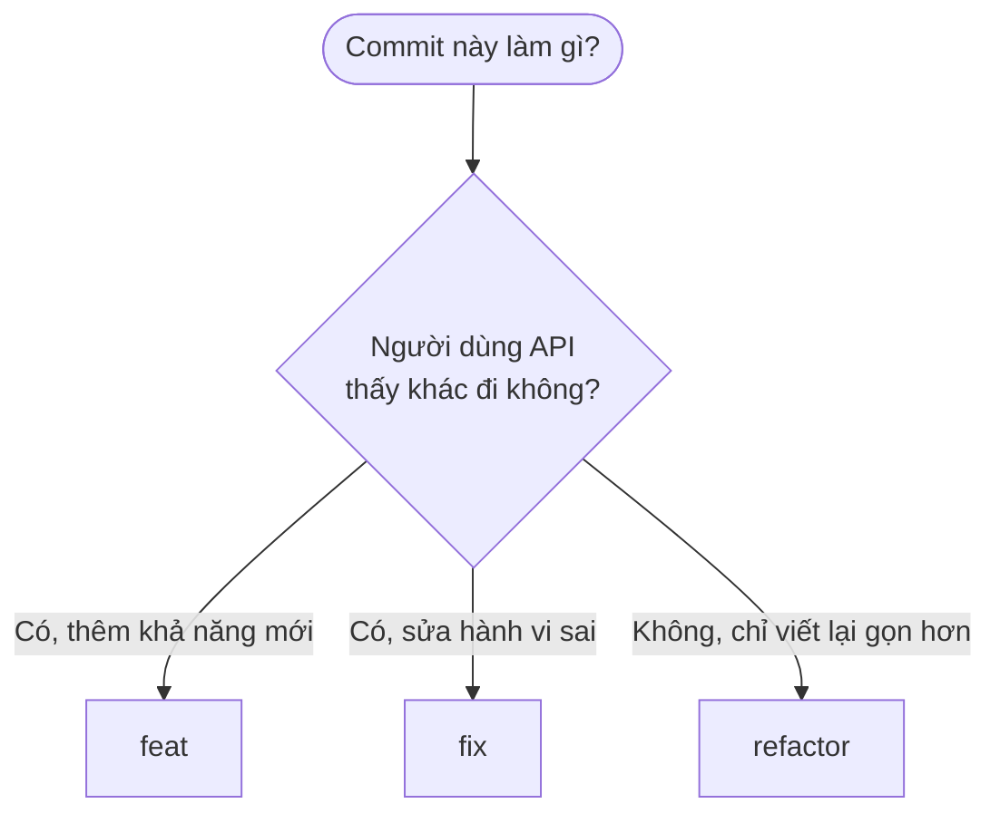
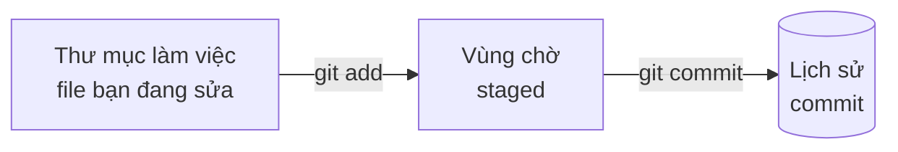

# Commit message — Quy ước đặt tên commit

> **Mục đích:** thống nhất cách viết message khi `git commit`, để nhìn `git log` là biết lịch sử dự án đã làm gì.
> **Quy ước dùng:** [Conventional Commits](https://www.conventionalcommits.org/). Các message trong [`PLAN.md`](../../PLAN.md) (dòng `Commit: ...`) đã theo đúng quy ước này.

## Mục lục

- [1. Cấu trúc một message](#1-cấu-trúc-một-message)
- [2. Các loại (type)](#2-các-loại-type)
- [3. Phạm vi (scope) trong dự án này](#3-phạm-vi-scope-trong-dự-án-này)
- [4. Cách viết phần mô tả](#4-cách-viết-phần-mô-tả)
- [5. Ví dụ tốt và xấu](#5-ví-dụ-tốt-và-xấu)
- [6. Lệnh git thường dùng](#6-lệnh-git-thường-dùng)
- [7. Sửa sai](#7-sửa-sai)
- [8. Quy trình commit trong dự án này](#8-quy-trình-commit-trong-dự-án-này)
- [9. Tự kiểm tra](#9-tự-kiểm-tra)

---

## 1. Cấu trúc một message

```
feat(common): correlation id middleware
 │      │             │
 │      │             └─ mô tả ngắn: commit này làm gì
 │      └─ phạm vi (scope): phần nào của dự án bị ảnh hưởng. Có thể bỏ
 └─ loại (type): commit này thuộc nhóm nào
```

Dạng đầy đủ khi cần giải thích thêm:

```
<type>(<scope>): <mô tả ngắn>

<thân: giải thích chi tiết hơn, vì sao làm vậy>
```

- **Dòng đầu** (tiêu đề) là bắt buộc. Thân (phần sau dòng trống) chỉ viết khi tiêu đề chưa đủ.
- Giữa tiêu đề và thân phải có **một dòng trống**.

---

## 2. Các loại (type)

| Loại | Dùng khi | Ví dụ |
|---|---|---|
| `feat` | Thêm **tính năng** mới | `feat(branches): public branch list with platform core` |
| `fix` | **Sửa lỗi** | `fix(common): reject correlation ids longer than 64 chars` |
| `docs` | Chỉ sửa **tài liệu** (`.md`) | `docs(knowledge): add middleware syntax reference` |
| `refactor` | Đổi cách viết code, **không đổi hành vi** | `refactor(data): use explicit constructor in ResultRow` |
| `test` | Chỉ thêm hoặc sửa **test** | `test(common): add boundary test for 64 chars` |
| `chore` | Việc vặt: cấu hình, dọn dẹp, scaffold | `chore: scaffold solution, api and test projects` |
| `ci` | Pipeline CI/CD, Docker | `ci: dockerize api and add CI pipeline` |
| `perf` | Cải thiện **hiệu năng** | `perf(transactions): index history search by date` |
| `style` | Chỉ đổi định dạng (khoảng trắng, thụt lề), không đổi logic | `style(common): align indentation` |

### Chọn `feat`, `fix` hay `refactor`?



> 💡 Một commit nên có **đúng một** loại. Nếu vừa thêm tính năng vừa sửa lỗi không liên quan, tách thành hai commit.

---

## 3. Phạm vi (scope) trong dự án này

Scope là tên khu vực bị ảnh hưởng. Lấy từ tên thư mục hoặc feature:

| Scope | Khu vực |
|---|---|
| `common` | `BankingSystem.Api/Common/` (envelope, middleware, JSON converter, phân trang) |
| `data` | `BankingSystem.Api/Data/` (gọi stored procedure) |
| `branches`, `auth`, `users`, `accounts`, `transactions`, `cards`, `loans`, `savings`, `notifications`, `admin` | Từng feature trong `Features/` |
| `security` | Bảo mật nâng cao (Task 21) |
| `infra` | Docker, load balancer, hạ tầng |
| `db` | Stored procedure, schema trong `database/` |
| `knowledge` | Sổ tay trong `docs/knowledge/` |

**Bỏ scope** khi commit chạm nhiều nơi hoặc không thuộc khu vực nào, ví dụ `docs: add knowledge section`, `chore: scaffold solution`.

---

## 4. Cách viết phần mô tả

| Quy tắc | Đúng | Sai |
|---|---|---|
| Dùng **động từ nguyên thể** | `add retry on timeout` | `added retry`, `adding retry` |
| Viết **thường** chữ đầu, **không dấu chấm** cuối | `fix login redirect` | `Fix login redirect.` |
| **Ngắn**: tiêu đề dưới khoảng 70 ký tự | `feat(auth): login with JWT` | một câu dài cả dòng |
| Nói **cái gì** thay đổi, không kể cách làm | `fix(common): reject unsafe ids` | `fix: changed || to && in IsValid` |
| **Một commit, một mục đích** | tách `feat` và `docs` | gộp mọi thứ trong ngày vào một commit |

Dự án này viết message bằng **tiếng Anh**, cùng ngôn ngữ với comment trong code.

### Khi nào cần phần thân?

Thêm thân khi người đọc sau này sẽ hỏi "vì sao?":

```
fix(common): set correlation header with OnStarting

The exception handler clears the response, so a header set directly in
InvokeAsync was lost on error responses. OnStarting runs after that step.
```

---

## 5. Ví dụ tốt và xấu

| Message | Đánh giá |
|---|---|
| `feat(common): correlation id middleware` | ✅ Đủ loại, scope, mô tả |
| `fix(branches): reject ids longer than 10 chars` | ✅ Nói rõ sửa gì |
| `docs: add commit message convention` | ✅ Bỏ scope hợp lý |
| `update` | ❌ Không biết update cái gì |
| `fix bug` | ❌ Bug nào? Ở đâu? |
| `Update Program.cs` | ❌ Chỉ nêu tên file, không nói **mục đích** |
| `feat: add middleware, fix typo, update readme` | ❌ Ba việc trong một commit, nên tách |
| `WIP` | ❌ Chưa xong thì chưa nên commit chung nhánh chính |

---

## 6. Lệnh git thường dùng

Git có **ba vùng**. Hiểu chúng là hiểu 90% `git commit`:



- `git add` chọn **file nào** sẽ vào commit (đưa vào vùng chờ).
- `git commit` chụp lại những gì **đang ở vùng chờ** và đặt message.

### Quy trình một commit

```bash
git status
```

Xem file nào đã sửa, file nào đã vào vùng chờ.

```bash
git add BankingSystem.Api/Common/CorrelationIdMiddleware.cs
```

Chỉ đưa các file thuộc **cùng một mục đích** vào vùng chờ. Tránh `git add .` khi chưa kiểm tra, vì dễ kéo theo file không liên quan (ví dụ `.vscode/settings.json`).

```bash
git diff --staged
```

Xem lại chính xác nội dung sắp commit.

```bash
git commit -m "feat(common): correlation id middleware"
```

### Các cách đặt message

| Muốn | Lệnh |
|---|---|
| Một dòng (hay dùng nhất) | `git commit -m "feat(common): correlation id middleware"` |
| Có thêm thân | `git commit -m "tiêu đề" -m "đoạn giải thích"` (mỗi `-m` là một đoạn) |
| Soạn trong trình soạn thảo | `git commit` (không `-m`) |

### Xem lịch sử

```bash
git log --oneline -10
```

10 commit gần nhất, mỗi commit một dòng. Đây là lúc quy ước message phát huy tác dụng.

---

## 7. Sửa sai

| Tình huống | Lệnh | Lưu ý |
|---|---|---|
| Đặt sai message của commit **vừa làm**, **chưa push** | `git commit --amend -m "message mới"` | Viết lại commit cuối |
| Quên một file trong commit vừa làm, **chưa push** | `git add file` rồi `git commit --amend --no-edit` | Giữ nguyên message |
| Muốn **bỏ commit vừa làm** nhưng giữ code, **chưa push** | `git reset --soft HEAD~1` | Code vẫn nằm trong vùng chờ |
| Commit **đã push** mà muốn đảo ngược | `git revert <mã commit>` | Tạo commit mới đảo ngược, không viết lại lịch sử |

> ⚠️ **Đừng dùng `git reset --hard`** khi chưa chắc: nó xoá luôn thay đổi chưa commit của bạn, không lấy lại được.
> ⚠️ **Đã push thì đừng `--amend` hay `reset`**: lịch sử trên server sẽ lệch với máy bạn và người khác bị ảnh hưởng.

Kiểm tra mã commit để `revert`:

```bash
git log --oneline -5
```

---

## 8. Quy trình commit trong dự án này

1. Làm xong một bước nhỏ, `dotnet build` và `dotnet test` **xanh**.
2. Dùng message đã gợi ý ở cuối mỗi task trong [`PLAN.md`](../../PLAN.md).
3. `git status` → `git add <các file đúng mục đích>` → `git diff --staged` → `git commit -m "..."`.
4. Tick `- [x]` mục tương ứng trong `PLAN.md`.

Theo [`AGENTS.md`](../../AGENTS.md): **AI agent chỉ gợi ý lệnh commit, bạn tự gõ**. Agent không chạy `git add`, `git commit`, `git push`, `git reset`.

### Ví dụ chia commit cho Task 25

| Commit | File | Message |
|---|---|---|
| 1 | `CorrelationIdMiddleware.cs`, `Program.cs`, `CorrelationIdMiddlewareTests.cs` | `feat(common): correlation id middleware` |
| 2 | `docs/knowledge/Middleware.md` | `docs(knowledge): add middleware syntax reference` |

Code và tài liệu tách riêng vì **mục đích khác nhau**: sau này cần xem lại lịch sử của middleware thì không bị lẫn commit tài liệu.

---

## 9. Tự kiểm tra

1. Trong `fix(branches): reject ids longer than 10 chars`, từng phần `fix`, `branches`, phần sau dấu `:` là gì?
2. Bạn vừa thêm middleware mới **và** sửa lỗi chính tả trong README. Nên commit thế nào?
3. Vì sao tránh `git add .` khi chưa chạy `git status`?
4. Bạn vừa commit và nhận ra gõ sai message, chưa push. Lệnh nào sửa?
5. `refactor(data): use explicit constructor in ResultRow`, vì sao dùng `refactor` mà không dùng `feat`?

<details>
<summary>Đáp án</summary>

1. `fix` là loại (sửa lỗi), `branches` là phạm vi (feature Branches), phần sau `:` là mô tả ngắn: từ chối id dài hơn 10 ký tự.
2. Hai commit riêng: `feat(common): ...` cho middleware và `docs: fix typo in readme`. Một commit một mục đích.
3. Vì nó thêm **mọi** file đã sửa, kể cả file bạn không định commit như `.vscode/settings.json`. `git status` cho bạn thấy trước rồi chọn từng file.
4. `git commit --amend -m "message mới"`.
5. Vì cách dùng ngoài (hành vi của API) không đổi, chỉ đổi cách viết bên trong. `feat` dành cho tính năng mới.

</details>
