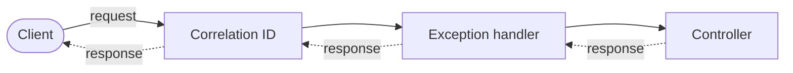
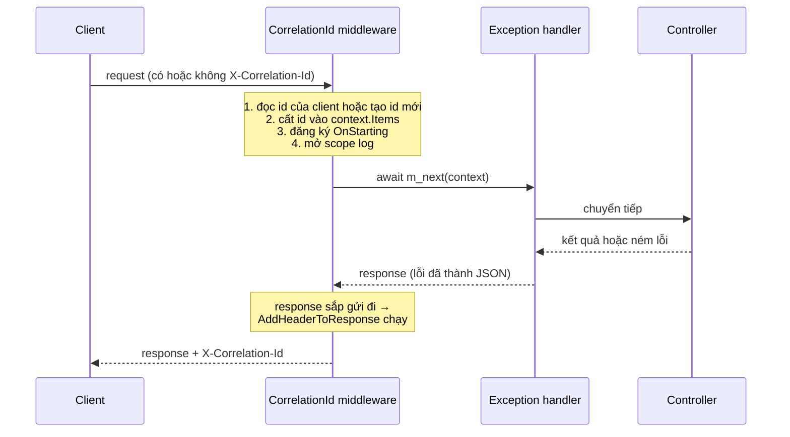
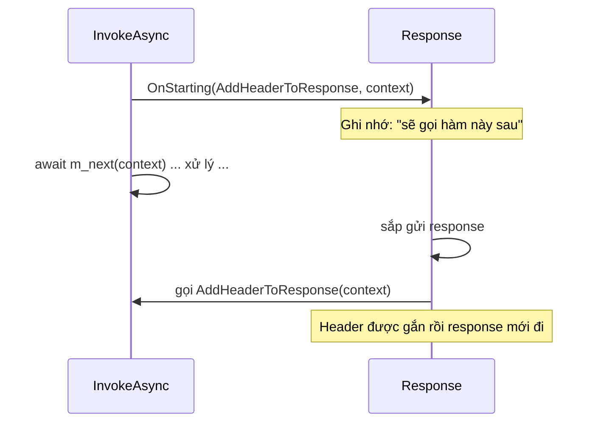

# Middleware — Sổ tay cú pháp

> **Mục đích:** tra cứu cú pháp C# và ASP.NET Core gặp trong **Task 25 (Correlation ID)**. Không cần thuộc lòng, chỉ cần biết "dòng này nghĩa là gì" khi gặp lại.
> **Code gốc:** [`CorrelationIdMiddleware.cs`](../../BankingSystem.Api/Common/CorrelationIdMiddleware.cs) · [`CorrelationIdMiddlewareTests.cs`](../../BankingSystem.Tests/CorrelationIdMiddlewareTests.cs)
> **Lộ trình:** [`PLAN.md`](../../PLAN.md) M7 (Task 25–28).

## Mục lục

- [1. Bức tranh lớn](#1-bức-tranh-lớn)
- [2. Đọc code từng khối](#2-đọc-code-từng-khối)
- [3. Từ điển cú pháp](#3-từ-điển-cú-pháp)
- [4. Cú pháp trong test](#4-cú-pháp-trong-test)
- [5. Hai lỗi đã gặp và bài học](#5-hai-lỗi-đã-gặp-và-bài-học)
- [6. Bảng đối chiếu C++ ↔ C#](#6-bảng-đối-chiếu-c--c)
- [7. Tự kiểm tra](#7-tự-kiểm-tra)

---

## 1. Bức tranh lớn

### 1.1 Middleware là gì?

Một **middleware** là một "trạm kiểm soát" mà mọi request phải đi qua trước khi tới Controller, và mọi response phải đi qua trên đường về. Các trạm xếp thành lớp như lớp vỏ hành tây:



- Đường liền (→) là **request đi vào**. Đường đứt (⇢) là **response đi ra**.
- Mỗi trạm làm việc **trước** khi chuyển request vào trong, và làm việc **sau** khi response quay ra.

### 1.2 Một request đi qua middleware Correlation ID



### 1.3 Bốn quy ước của một middleware

| # | Quy ước | Trong file của bạn |
|---|---|---|
| 1 | Là `public class` | `public class CorrelationIdMiddleware` |
| 2 | Constructor nhận `RequestDelegate next` (và các service khác nếu cần) | `CorrelationIdMiddleware(RequestDelegate next, ILogger<...> logger)` |
| 3 | Có method tên **đúng** `InvokeAsync(HttpContext context)` trả về `Task` | `public async Task InvokeAsync(HttpContext context)` |
| 4 | Gọi `next` để chuyển request vào trong. **Quên gọi = request dừng tại đây, client nhận response rỗng** | `await m_next(context);` |

> ⚠️ **Thứ tự đăng ký trong `Program.cs` chính là thứ tự chạy.** Middleware nào đứng trên thì bọc ngoài các middleware bên dưới.

```csharp
app.UseMiddleware<CorrelationIdMiddleware>();   // đứng ngoài cùng, chạy đầu tiên
app.UseExceptionHandler();                      // bọc bên trong
```

### 1.4 Thứ tự đầy đủ dự kiến của dự án

```
Correlation ID → Request logging → UseExceptionHandler → Security headers
→ UseHttpsRedirection → CORS → Rate limiting → Authentication → Authorization → MapControllers
```

Lý do từng vị trí nằm trong [`PLAN.md`](../../PLAN.md) mục M7.

---

## 2. Đọc code từng khối

Code dưới đây giữ nguyên logic file thật, chỉ bỏ bớt khoảng trắng. Số trong ngoặc `(1)`, `(2)`… trỏ tới bảng giải thích ngay bên dưới mỗi khối.

### Khối A: khai báo class và các hằng số

```csharp
namespace BankingSystem.Api.Common;                                   // (1)

public class CorrelationIdMiddleware                                  // (2)
{
    public const string HeaderName = "X-Correlation-Id";              // (3)
    private const string ItemsKey = "CorrelationId";                  // (3)
    private const int MaxLength = 64;                                 // (3)

    private readonly RequestDelegate m_next;                          // (4)
    private readonly ILogger<CorrelationIdMiddleware> m_logger;       // (5)
```

| # | Cú pháp | Nghĩa |
|---|---|---|
| 1 | `namespace X;` (có dấu `;`, không có `{}`) | Mọi thứ trong file này thuộc namespace `X`. Giống `namespace X { ... }` của C++ nhưng bao cả file |
| 2 | `public class` | Ai cũng dùng được class này. Tên file nên trùng tên class |
| 3 | `const` | Hằng số, xác định lúc biên dịch, **không bao giờ đổi**. `const` mặc định là `static`, nên gọi được bằng `CorrelationIdMiddleware.HeaderName` mà không cần tạo object |
| 4 | `private readonly` | `private`: chỉ trong class này. `readonly`: chỉ được gán **một lần**, trong constructor |
| 5 | `ILogger<T>` | Công cụ ghi log. `<T>` cho biết log này do class nào ghi (hiện trong dòng log) |

### Khối B: constructor

```csharp
public CorrelationIdMiddleware(RequestDelegate next, ILogger<CorrelationIdMiddleware> logger)
{
    this.m_next = next;                                               // (1)
    this.m_logger = logger;                                           // (1)
}
```

| # | Cú pháp | Nghĩa |
|---|---|---|
| 1 | `this.m_next = next;` | `this` là chính object đang tạo. Vế trái là **field**, vế phải là **tham số**. Tiền tố `m_` là quy ước của bạn để phân biệt field với tham số |

> 💡 **Ai truyền `next` và `logger` vào?** ASP.NET Core tự làm khi khởi động (kỹ thuật này gọi là **Dependency Injection**). Bạn không bao giờ viết `new CorrelationIdMiddleware(...)`.
> Middleware chỉ được tạo **một lần** lúc app khởi động và dùng chung cho mọi request. Vì vậy **đừng** lưu dữ liệu riêng của từng request vào field của class; đó là lý do id được cất vào `context.Items`.

### Khối C: `InvokeAsync`, trái tim của middleware

```csharp
public async Task InvokeAsync(HttpContext context)                    // (1)
{
    var correlationId = ReadOrCreateId(context);                      // (2)

    context.Items[ItemsKey] = correlationId;                          // (3)

    context.Response.OnStarting(AddHeaderToResponse, context);        // (4)

    var scope = new Dictionary<string, object>                        // (5)
    {
        ["CorrelationId"] = correlationId
    };

    using (m_logger.BeginScope(scope))                                // (6)
    {
        await m_next(context);                                        // (7)
    }
}
```

| # | Cú pháp | Nghĩa |
|---|---|---|
| 1 | `async Task` | Method bất đồng bộ, không trả giá trị. `HttpContext` chứa **mọi thứ về request hiện tại** (request, response, headers, user...) |
| 2 | `var` | Compiler tự suy ra kiểu (ở đây là `string`). Vẫn là kiểu tĩnh, không phải kiểu động |
| 3 | `context.Items[key] = value` | Một "cái túi" gắn với **đúng request này**, để các đoạn code khác nhau của cùng request chia sẻ dữ liệu |
| 4 | `OnStarting(AddHeaderToResponse, context)` | "Hãy gọi hàm `AddHeaderToResponse` ngay trước khi response bắt đầu được gửi, và đưa `context` cho nó". **Không có `()`** sau tên hàm vì mình đưa hàm đi, chưa gọi (xem mục 3.4) |
| 5 | `new Dictionary<string, object> { ["k"] = v }` | Từ điển (key → value). Phần `{ ["k"] = v }` là cách vừa tạo vừa điền giá trị |
| 6 | `using (...) { ... }` | Hết khối `{}` thì tự dọn dẹp (gọi `Dispose()`), kể cả khi có lỗi. Giống RAII trong C++. Ở đây "scope log" tự đóng khi request qua hết |
| 7 | `await m_next(context)` | Gọi middleware kế tiếp rồi **chờ** nó xong. `m_next` là một "hàm", viết `m_next(context)` là gọi hàm đó |

> 💡 **Trước hay sau `await m_next`?** Mọi dòng **trước** nó chạy lúc request đi vào. Mọi dòng **sau** nó (nếu có) chạy lúc response quay ra.

### Khối D: hàm được gọi khi response sắp gửi

```csharp
private static Task AddHeaderToResponse(object state)                 // (1)
{
    var context = (HttpContext)state;                                 // (2)
    var correlationId = (string)context.Items[ItemsKey]!;             // (3)

    context.Response.Headers[HeaderName] = correlationId;             // (4)

    return Task.CompletedTask;                                        // (5)
}
```

| # | Cú pháp | Nghĩa |
|---|---|---|
| 1 | `static` + tham số `object state` | `static`: không cần object, giống hàm tĩnh của C++. `object` là kiểu "chứa được mọi thứ". Hàm phải nhận `object` vì `OnStarting` bắt buộc dạng này |
| 2 | `(HttpContext)state` | **Ép kiểu (cast)**: nói với compiler "giá trị này thực ra là `HttpContext`". Sai kiểu thì lỗi lúc chạy (`InvalidCastException`). Đây chính là `context` bạn truyền ở dòng (4) của khối C |
| 3 | `(string)...!` | Ép về `string`. Dấu `!` ở cuối là **null-forgiving**: "tôi đảm bảo giá trị này không null, đừng cảnh báo". Chỉ tác dụng lúc biên dịch, không kiểm tra gì lúc chạy |
| 4 | `Headers[name] = value` | Gán header cho response. Gán lại thì ghi đè giá trị cũ |
| 5 | `Task.CompletedTask` | Hàm bắt buộc trả `Task` nhưng không có việc bất đồng bộ nào để làm, nên trả về "một Task đã hoàn thành sẵn" |

### Khối E: đọc id và kiểm tra id

```csharp
private static string ReadOrCreateId(HttpContext context)
{
    var incoming = context.Request.Headers[HeaderName].ToString();   // (1)

    if (IsValid(incoming)) return incoming;                          // (2)

    return Guid.NewGuid().ToString();                                // (3)
}

private static bool IsValid(string? id)                              // (4)
{
    if (string.IsNullOrEmpty(id)) return false;                      // (5)
    if (id.Length > MaxLength) return false;

    foreach (var c in id)                                            // (6)
        if (!char.IsAsciiLetterOrDigit(c) && c != '-')               // (7)
            return false;

    return true;
}
```

| # | Cú pháp | Nghĩa |
|---|---|---|
| 1 | `Headers[name].ToString()` | Header có thể có nhiều giá trị nên kiểu trả về là `StringValues`. `.ToString()` ghép chúng thành một chuỗi, ngăn cách bằng dấu phẩy. Dấu phẩy không hợp lệ theo quy tắc của ta, nên id kiểu đó sẽ bị bỏ |
| 2 | `if (...) return x;` (không `{}`) | Khi chỉ có **một lệnh**, `{}` được phép bỏ. Cẩn thận: thêm lệnh thứ hai mà quên `{}` là lỗi kinh điển |
| 3 | `Guid.NewGuid()` | Sinh một mã ngẫu nhiên 128 bit. `.ToString()` ra dạng `d9f1b2c3-...` (36 ký tự gồm chữ, số, `-`), nên **chính nó cũng hợp lệ** theo `IsValid` |
| 4 | `string? id` | Dấu `?` sau kiểu: tham số **được phép null** (nullable reference type). Chỉ là chú thích để compiler cảnh báo giúp bạn |
| 5 | `string.IsNullOrEmpty(id)` | `true` nếu `id` là `null` hoặc `""`. Sau dòng này compiler biết `id` không còn null nên dòng dưới dùng `id.Length` không bị cảnh báo |
| 6 | `foreach (var c in id)` | Duyệt từng ký tự của chuỗi |
| 7 | `&&` và `!` | `&&`: **và**. `!`: **phủ định**. Đọc là: "ký tự này *không phải* chữ/số **và** *không phải* dấu `-`" thì từ chối |

---

## 3. Từ điển cú pháp

### 3.1 Khai báo và từ khoá

| Cú pháp | Nghĩa | Gần giống C++ | Ví dụ trong file |
|---|---|---|---|
| `public` / `private` | Ai được truy cập | `public:` / `private:` | `private readonly ... m_next` |
| `const` | Hằng số lúc biên dịch | `constexpr` | `MaxLength = 64` |
| `readonly` | Gán một lần, trong constructor | `const` member gán ở initializer list | `m_next`, `m_logger` |
| `static` | Thuộc về class, không cần object | `static` member function | `IsValid`, `ReadOrCreateId` |
| `this.` | Chính object hiện tại (là tham chiếu, không phải con trỏ) | `this->` | `this.m_next = next;` |
| `m_` tiền tố | Quy ước đặt tên field của bạn | Quy ước `m_member` quen thuộc | `m_logger` |
| `namespace X;` | Gom code vào một không gian tên | `namespace X { }` | `BankingSystem.Api.Common` |

> 💡 **Vì sao không thấy `using System;`?** Dự án bật *implicit usings*: .NET tự thêm sẵn các namespace hay dùng (`System`, `System.Collections.Generic`, `System.Threading.Tasks`, `Microsoft.AspNetCore.Http`...). Nên `Task`, `Dictionary`, `Guid`, `HttpContext` dùng được ngay.

### 3.2 Kiểu dữ liệu và null

| Cú pháp | Nghĩa | Ví dụ |
|---|---|---|
| `var` | Compiler tự suy ra kiểu | `var scope = new Dictionary<...>` |
| `string?` | Kiểu string **có thể null** | `IsValid(string? id)` |
| `x!` | Null-forgiving: bảo compiler "chắc chắn không null" | `context.Items[ItemsKey]!` |
| `(T)x` | Ép kiểu. Sai kiểu thì ném `InvalidCastException` lúc chạy | `(HttpContext)state` |
| `object` | Kiểu gốc của mọi kiểu, chứa được mọi giá trị | `object state` |
| `<T>` (generic) | "Kiểu này áp dụng cho kiểu T". Giống `template<T>` của C++ | `ILogger<CorrelationIdMiddleware>`, `Dictionary<string, object>` |

### 3.3 Bất đồng bộ

| Cú pháp | Nghĩa |
|---|---|
| `Task` | Đại diện cho một công việc đang/đã chạy, không trả giá trị. `Task<T>` thì trả giá trị kiểu `T` |
| `async` | Đánh dấu method được phép dùng `await` bên trong |
| `await x` | "Chờ `x` xong rồi mới chạy tiếp". Trong lúc chờ, **luồng xử lý được trả lại** cho hệ thống để phục vụ request khác, không bị đứng |
| `Task.CompletedTask` | Một `Task` đã xong sẵn, dùng khi hàm bắt buộc trả `Task` mà không có gì để chờ |

### 3.4 Hàm cũng là một giá trị (delegate)

Trong C#, một hàm có thể được **đưa đi như dữ liệu** để nơi khác gọi giúp. Loại biến chứa hàm gọi là **delegate**.

```csharp
context.Response.OnStarting(AddHeaderToResponse, context);   // đưa hàm đi, chưa gọi
AddHeaderToResponse(context);                                // gọi hàm ngay lập tức
```

| Cú pháp | Nghĩa |
|---|---|
| `AddHeaderToResponse` (không `()`) | **Tên hàm**: đưa hàm đi để người khác gọi sau. Gọi là *method group* |
| `AddHeaderToResponse(x)` (có `()`) | **Gọi hàm** ngay bây giờ |
| `RequestDelegate` | Kiểu hàm "nhận `HttpContext`, trả `Task`". Chính là middleware kế tiếp. `m_next(context)` gọi nó |
| `OnStarting(callback, state)` | "Gọi `callback(state)` ngay trước khi gửi response". `state` là thứ bạn muốn hàm nhận lại |



### 3.5 Collection và vòng lặp

| Cú pháp | Nghĩa | Ví dụ |
|---|---|---|
| `Dictionary<string, object>` | Từ điển key kiểu `string`, value kiểu `object` | scope log |
| `{ ["k"] = v }` | Vừa tạo vừa điền: key `"k"` có giá trị `v` | `{ ["CorrelationId"] = correlationId }` |
| `dict[key]` | Đọc hoặc ghi giá trị theo key | `context.Items[ItemsKey]` |
| `foreach (var x in list)` | Duyệt từng phần tử | duyệt từng ký tự của `id` |

### 3.6 Tài nguyên, log và DI

| Cú pháp | Nghĩa |
|---|---|
| `using (x) { ... }` | Hết khối thì tự `Dispose()` x, kể cả khi có lỗi. Giống RAII |
| `BeginScope(state)` | Mọi dòng log ghi **trong lúc scope còn mở** sẽ đính kèm `state`. Phải bật `IncludeScopes: true` trong `appsettings.Development.json` mới thấy trên console |
| **Dependency Injection** | Class khai báo cần gì ở constructor, framework tự truyền vào. Đăng ký ở `Program.cs` |
| `ILogger<T>` | Service ghi log, luôn có sẵn, không cần đăng ký |

### 3.7 Các hàm tiện ích

| Hàm | Nghĩa | Ví dụ |
|---|---|---|
| `string.IsNullOrEmpty(s)` | `true` nếu `s` là null hoặc rỗng | kiểm tra id |
| `char.IsAsciiLetterOrDigit(c)` | `true` nếu `c` là a–z, A–Z hoặc 0–9 | kiểm tra từng ký tự |
| `Guid.NewGuid()` | Sinh mã ngẫu nhiên 128 bit | tạo id mới |
| `x.ToString()` | Đổi thành chuỗi | |

### 3.8 Đăng ký middleware

```csharp
app.UseMiddleware<CorrelationIdMiddleware>();
```

`<CorrelationIdMiddleware>` là generic: "đăng ký middleware thuộc **kiểu này**". Framework tự tạo object và truyền `next`, `logger` vào constructor.

> 💡 **Mẹo đọc code lạ:** trong VS Code, giữ `Ctrl` và bấm vào một tên (ví dụ `OnStarting`, `RequestDelegate`) để nhảy tới định nghĩa. Rê chuột lên để xem kiểu và mô tả.

---

## 4. Cú pháp trong test

```csharp
public class CorrelationIdMiddlewareTests : IClassFixture<WebApplicationFactory<Program>>   // (1)
{
    private readonly HttpClient m_client;

    public CorrelationIdMiddlewareTests(WebApplicationFactory<Program> factory)             // (2)
    {
        this.m_client = factory.CreateClient();                                             // (3)
    }

    [Fact]                                                                                  // (4)
    public async Task Request_WithoutHeader_GetsGeneratedGuid()                             // (5)
    {
        var response = await m_client.GetAsync("/api/branches");                            // (6)

        var correlationId = response.Headers.GetValues(HeaderName).Single();                // (7)
        Assert.True(Guid.TryParse(correlationId, out _));                                   // (8)
    }

    [Theory]                                                                                // (9)
    [InlineData("has space")]
    [InlineData("semi;colon")]
    public async Task Request_WithUnsafeHeader_GetsNewGuid(string unsafeId) { ... }
}
```

| # | Cú pháp | Nghĩa |
|---|---|---|
| 1 | `IClassFixture<WebApplicationFactory<Program>>` | Yêu cầu xUnit tạo **một** `WebApplicationFactory` dùng chung cho cả class và đưa vào constructor. Factory chạy API **trong bộ nhớ** (vì thế `Program.cs` cần `public partial class Program`) |
| 2 | Constructor nhận `factory` | xUnit tự truyền vào. Mỗi test chạy trên một object class mới, nên constructor chạy trước mỗi test |
| 3 | `factory.CreateClient()` | Tạo `HttpClient` gọi thẳng vào API trong bộ nhớ, không mở cổng mạng |
| 4 | `[Fact]` | **Attribute** (nhãn đặt trong `[ ]`): "method này là một bài test". `dotnet test` tìm mọi method có nhãn này để chạy |
| 5 | Tên `Method_Scenario_Expected` | Đọc tên là biết test kiểm cái gì: "request không có header thì nhận GUID mới" |
| 6 | `await ... GetAsync(...)` | Gửi request GET và chờ response. Test cũng là `async Task` |
| 7 | `.Single()` | Lấy phần tử **duy nhất** của danh sách. Có 0 hoặc nhiều hơn 1 phần tử thì lỗi. Nên dòng này vừa kiểm "header có mặt" vừa kiểm "chỉ một lần" |
| 8 | `out _` | `TryParse` trả `true/false` và còn trả giá trị qua tham số `out`. `_` là "ô bỏ đi", báo rằng ta không cần giá trị đó |
| 9 | `[Theory]` + `[InlineData(...)]` | Chạy **cùng một test nhiều lần** với dữ liệu khác nhau. Mỗi `[InlineData]` là một lần chạy, giá trị đưa vào tham số `unsafeId` |

### Các câu `Assert`

| Câu | Pass khi |
|---|---|
| `Assert.True(x)` | `x` là `true` |
| `Assert.Equal(expected, actual)` | hai giá trị bằng nhau (**expected đứng trước**) |
| `Assert.NotEqual(a, b)` | hai giá trị khác nhau |

### Mẫu "Sắp xếp, Hành động, Kiểm tra" (Arrange, Act, Assert)

```csharp
var tooLong = new string('a', 65);                                       // Arrange: chuẩn bị (65 chữ 'a')
var response = await SendWithCorrelationIdAsync(url, tooLong);           // Act:     làm việc cần kiểm
var id = response.Headers.GetValues(HeaderName).Single();                // ┐
Assert.NotEqual(tooLong, id);                                            // ┘ Assert:  kiểm kết quả
```

### Gửi request kèm header riêng

```csharp
var request = new HttpRequestMessage(HttpMethod.Get, url);               // tạo request thủ công
request.Headers.TryAddWithoutValidation(HeaderName, correlationId);      // gắn header, kể cả giá trị .NET thường từ chối
return await m_client.SendAsync(request);                                // gửi đi
```

`GetAsync(url)` không cho gắn header riêng từng lần gọi nên phải dựng `HttpRequestMessage`.

### Test sát ngưỡng (boundary)

`MaxLength` là 64, nên test dùng **65** ký tự: giá trị nhỏ nhất đã vượt ngưỡng. Lỗi hay gặp là lệch một đơn vị, ví dụ lỡ viết điều kiện cho phép cả 65 ký tự; test 65 bắt được lỗi đó, còn test 100 ký tự thì bỏ lọt.

Test sát ngưỡng đầy đủ có **hai phía**: 65 phải bị từ chối, và 64 phải được chấp nhận. Hiện file test mới có phía 65. Phía 64 (id đúng 64 ký tự phải được giữ nguyên) là bài tập nhỏ bạn có thể tự thêm.

---

## 5. Hai lỗi đã gặp và bài học

### Lỗi 1: viết hàm xong nhưng chưa đăng ký

`AddHeaderToResponse` đã viết đủ, nhưng thiếu dòng `context.Response.OnStarting(AddHeaderToResponse, context);`. Kết quả: **7 test fail**, response không có header.

> **Bài học:** một hàm tự nằm trong class thì không chạy. Phải có chỗ nào đó gọi nó, hoặc nhờ framework gọi hộ.

### Lỗi 2: `||` thay vì `&&`

```csharp
if (!char.IsAsciiLetterOrDigit(c) || c != '-')   // ❌ từ chối mọi ký tự
if (!char.IsAsciiLetterOrDigit(c) && c != '-')   // ✅ chỉ từ chối ký tự "không phải chữ/số VÀ không phải dấu -"
```

Bảng chân trị cho thấy vì sao bản `||` sai:

| `c` | `!IsAsciiLetterOrDigit(c)` | `c != '-'` | `\|\|` | `&&` | Mong muốn |
|---|---|---|---|---|---|
| `'a'` (hợp lệ) | false | true | **true** ❌ từ chối nhầm | false ✅ | giữ lại |
| `'-'` (hợp lệ) | true | false | **true** ❌ từ chối nhầm | false ✅ | giữ lại |
| `' '` (không hợp lệ) | true | true | true ✅ | true ✅ | từ chối |

> **Bài học:** khi gặp điều kiện kiểu "không thuộc A **và** không thuộc B", hãy lập bảng chân trị cho vài giá trị mẫu. Đừng tin vào cảm giác.

### Vì sao header phải gắn bằng `OnStarting`, không gắn thẳng?

Đã thử thực tế:

| Cách gắn header | Request thành công | Request lỗi (exception handler trả) |
|---|---|---|
| `Response.Headers[...] = id` ngay trong `InvokeAsync` | Có header | **Mất header** |
| `OnStarting(AddHeaderToResponse, context)` | Có header | Có header |

Lý do: khi có lỗi, exception handler **xoá sạch response** (gồm header) rồi mới ghi JSON lỗi. `OnStarting` chạy ở ngay trước khi gửi, **sau** bước xoá đó. Test `ErrorResponse_AlsoHasHeader` bảo vệ điều này.

---

## 6. Bảng đối chiếu C++ ↔ C#

| Ý định | C++ | C# |
|---|---|---|
| Truy cập thành viên của chính mình | `this->x` | `this.x` |
| Hằng số | `constexpr int N = 64;` | `const int N = 64;` |
| Gán một lần trong constructor | `const` member + initializer list | `readonly` field |
| Hàm tĩnh | `static void F()` | `static void F()` |
| Template | `template<typename T>` | `Class<T>` (generic) |
| Dọn tài nguyên khi hết phạm vi | RAII, destructor | `using (x) { }` |
| Con trỏ hàm / `std::function` | `std::function<void(int)>` | delegate (`RequestDelegate`, `Func<>`) |
| Kế thừa class cha ở constructor | `: Base(args)` | `: base(args)` |
| Cho phép null | con trỏ `T*` | `string?` |
| Bỏ qua tham số `out` | (không có) | `out _` |

---

## 7. Tự kiểm tra

Thử trả lời bằng lời trước khi mở đáp án.

1. Vì sao `AddHeaderToResponse` là `static` và nhận `object state` thay vì dùng thẳng biến `correlationId`?
2. Nếu xoá dòng `await m_next(context);` thì chuyện gì xảy ra với mọi request?
3. Vì sao không lưu `correlationId` vào một field của class (`private string m_id;`)?
4. `OnStarting(AddHeaderToResponse, context)` khác `AddHeaderToResponse(context)` ở điểm nào?
5. Vì sao test dùng chuỗi 65 ký tự mà không phải 100?

<details>
<summary>Đáp án</summary>

1. `OnStarting` yêu cầu hàm có dạng "nhận một `object`". Hàm `static` không nhìn thấy biến cục bộ của `InvokeAsync`, nên mọi thứ cần dùng phải được đưa vào qua `state` (ở đây là `context`), id thì lấy lại từ `context.Items`.
2. Request dừng ngay tại middleware này. Không controller nào chạy, client nhận response rỗng. Mọi test gọi API sẽ fail.
3. Middleware chỉ được tạo **một lần** và dùng chung cho mọi request chạy cùng lúc. Lưu id vào field thì các request ghi đè lên nhau. `context.Items` thì riêng từng request.
4. Cái đầu **đưa hàm đi** để framework gọi sau (ngay trước khi gửi response). Cái sau **gọi ngay** bây giờ, lúc response chưa có gì để gắn.
5. Vì 65 là giá trị nhỏ nhất vượt ngưỡng 64. Nếu code lỡ cho phép cả 65 ký tự (lệch một đơn vị), test 65 bắt được lỗi, còn chuỗi 100 ký tự vẫn bị từ chối nên lỗi lọt qua. (Lỗi ngược lại, từ chối nhầm id đúng 64 ký tự, cần thêm một test dùng 64.)

</details>
