# Pipeline — Luồng xử lý & quy trình phát triển

> **Loại tài liệu:** gồm 2 loại "pipeline" người ta hay nói tới:
> 1. **Runtime pipeline**: một request / một nghiệp vụ chạy qua hệ thống thế nào (§1–§2).
> 2. **Delivery pipeline (CI/CD)**: code đi từ máy bạn tới bản chạy được thế nào (§3–§4).
>
> Kiến trúc tầng: [`system_design.md`](system_design.md) §3. Quy tắc nghiệp vụ: [`SRS/01_SRS.md`](SRS/01_SRS.md) §5.

## Mục lục

- [1. Request pipeline](#1-request-pipeline)
- [2. Luồng nghiệp vụ chính](#2-luồng-nghiệp-vụ-chính)
- [3. Quy trình phát triển](#3-quy-trình-phát-triển)
- [4. CI/CD pipeline](#4-cicd-pipeline)

---

## 1. Request pipeline

Thứ tự middleware trong `Program.cs` quyết định request bị chặn ở đâu. Thứ tự sai là lỗi bảo mật.

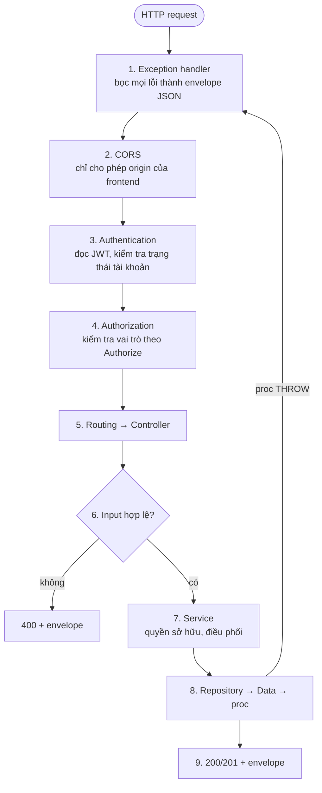

| Bước | Thất bại thì trả |
|---|---|
| 3. Không có token / token sai / tài khoản bị khoá | `401` |
| 4. Sai vai trò | `403` |
| 6. Input sai định dạng | `400` |
| 7. Tài nguyên không thuộc người dùng | `403` |
| 8. Vi phạm quy tắc nghiệp vụ (proc `THROW`) | `404` / `409` / `422` theo [`api_contract.md`](api_contract.md) §2 |
| Lỗi không lường trước | `500` |

---

## 2. Luồng nghiệp vụ chính

### 2.1 Đăng ký & kích hoạt (UC-01)

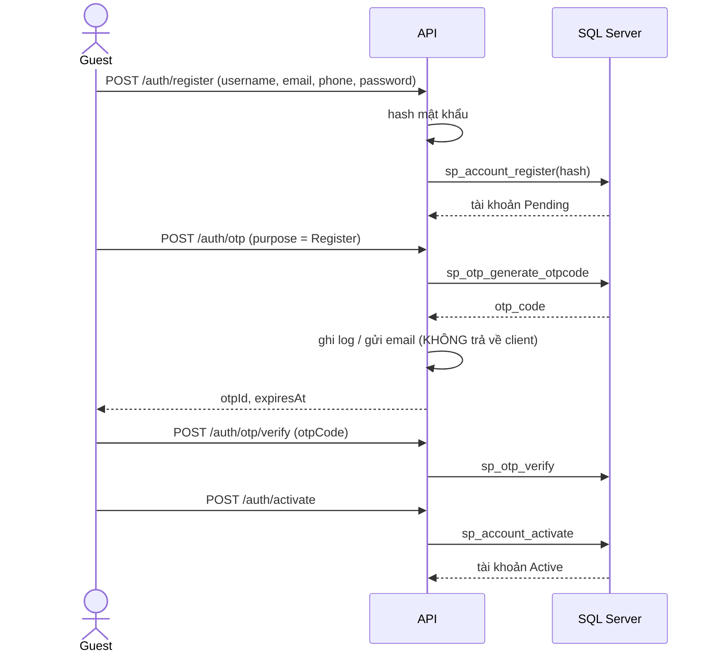

### 2.2 Đăng nhập (UC-02)

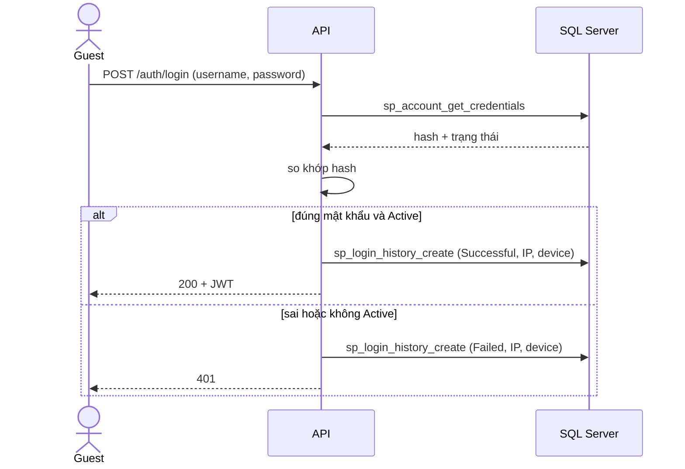

### 2.3 Chuyển khoản (UC-11)

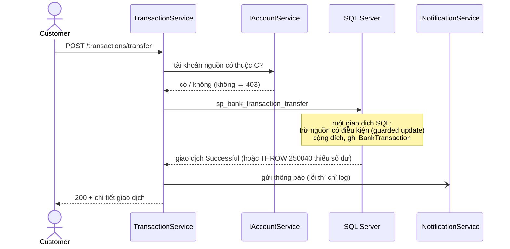

### 2.4 Vòng đời trạng thái

**Tài khoản đăng nhập**
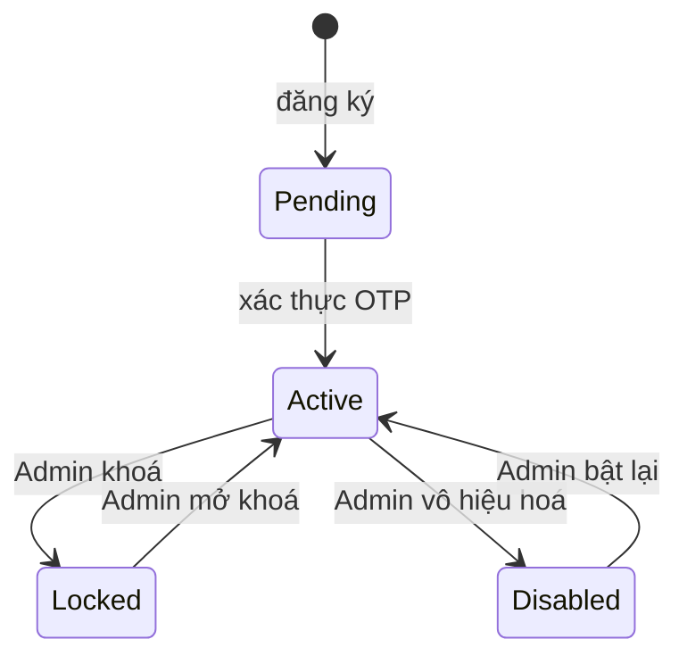

**Tài khoản ngân hàng**
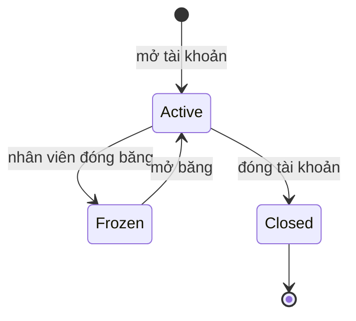

**Khoản vay**
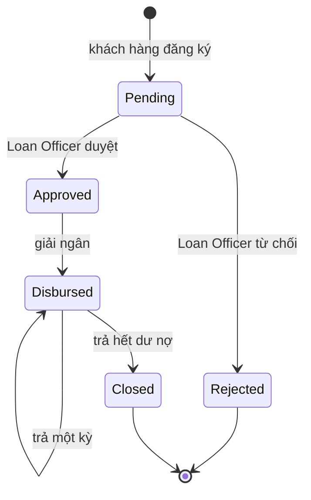

**Sổ tiết kiệm**
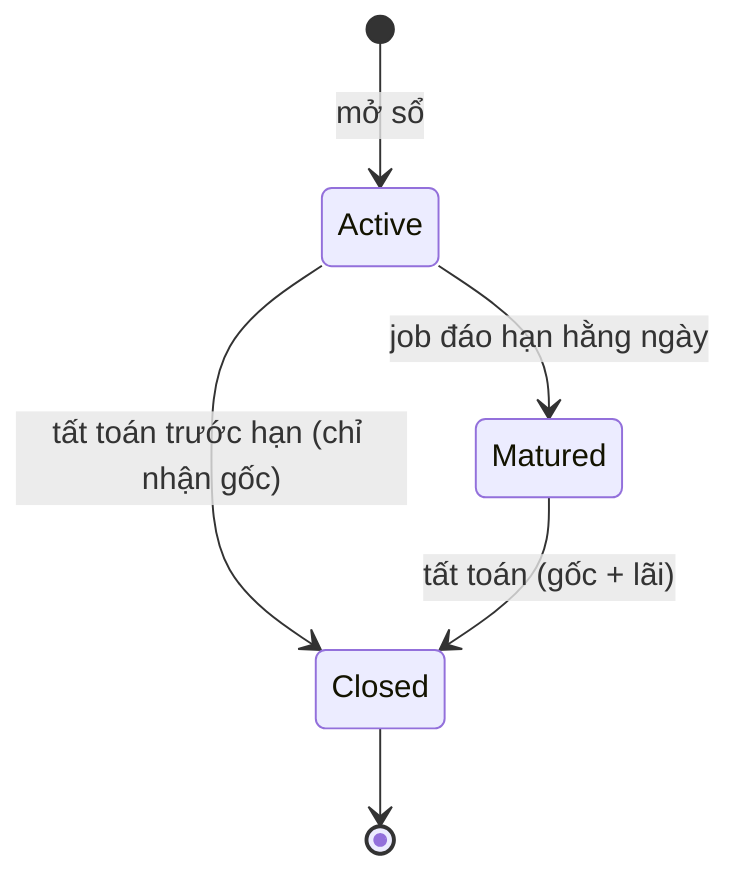

**Thẻ**
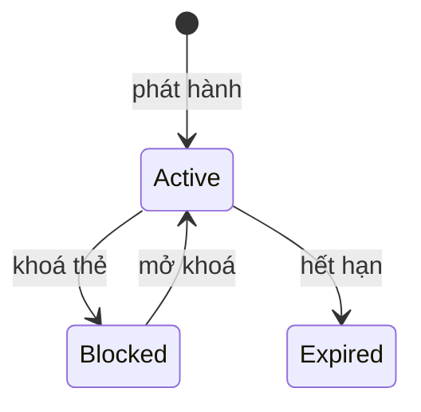

> Các chuyển trạng thái do proc kiểm soát. Sơ đồ mô tả hành vi mong đợi để viết test. Nếu proc cho phép khác đi, sửa sơ đồ theo proc.

---

## 3. Quy trình phát triển

### 3.1 Vòng làm một task

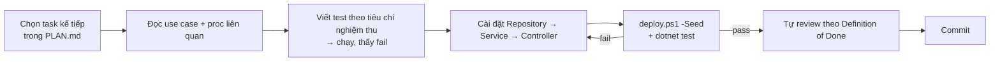

### 3.2 Definition of Done

Một task chỉ coi là xong khi đủ các điều sau:

- [ ] Mọi tiêu chí nghiệm thu trong `PLAN.md` có test và test xanh.
- [ ] `dotnet build` không cảnh báo mới; `dotnet test` xanh trên DB vừa dựng lại bằng `deploy.ps1 -Seed`.
- [ ] Response đúng [`api_contract.md`](api_contract.md): envelope, tiền là chuỗi, ngày không offset, enum đúng chuỗi gốc.
- [ ] Không lộ `password_hash`, `otp_code`, số thẻ đầy đủ (trừ lúc phát hành thẻ).
- [ ] Endpoint có id tài nguyên của khách hàng đã kiểm tra quyền sở hữu.
- [ ] Đã cập nhật tài liệu nếu hành vi khác với tài liệu.

### 3.3 Quy ước git

| Mục | Quy ước |
|---|---|
| Nhánh | `master` luôn chạy được; mỗi task một nhánh `feature/<tên-task>` khi muốn thử nghiệm dài |
| Commit message | Conventional Commits: `feat(accounts): open banking account`, `fix(auth): log failed login`, `docs: update SRS`, `test(transactions): concurrent transfer` |
| Kích thước commit | Mỗi commit một ý, build được |

---

## 4. CI/CD pipeline

> Trạng thái: **chưa có**. Dựng ở milestone M5 trong `PLAN.md`. Dưới đây là thiết kế.

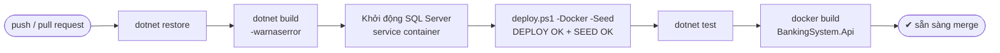

| Stage | Mục đích | Fail khi |
|---|---|---|
| Build | Code biên dịch được | Lỗi biên dịch hoặc cảnh báo |
| Deploy DB | Schema + proc dựng được từ đầu (bắt lỗi deferred name resolution) | `deploy.ps1` không in `DEPLOY OK` / `SEED OK` |
| Test | Hành vi đúng trên DB thật | Có test đỏ |
| Docker image | Đóng gói được | `docker build` lỗi |

Công cụ dự kiến: GitHub Actions, workflow `.github/workflows/ci.yml`. Chưa có bước tự động triển khai lên server (CD), vì đây là đồ án chạy local.
