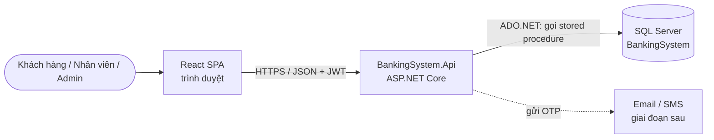
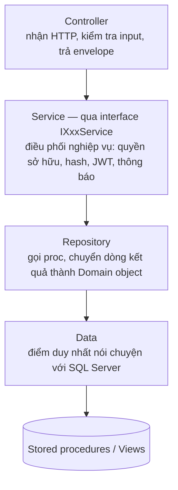
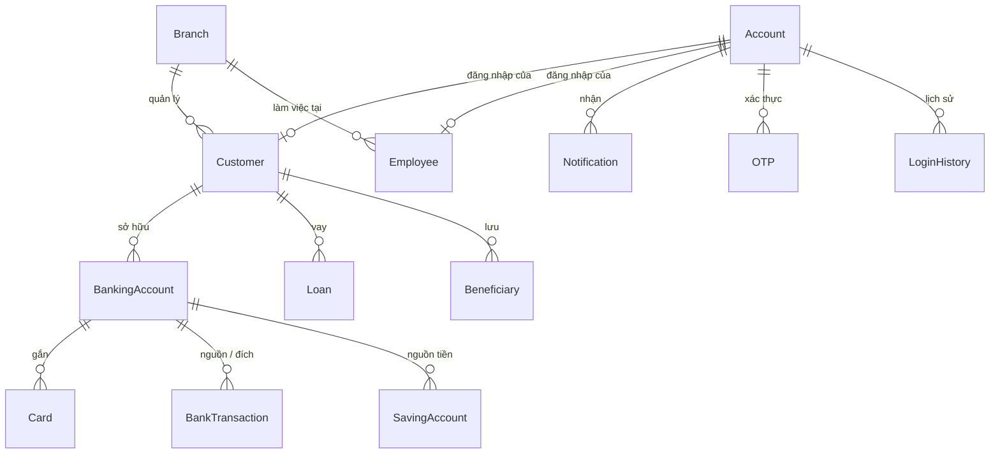
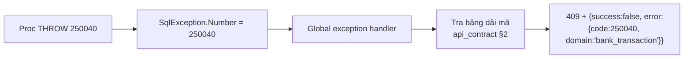
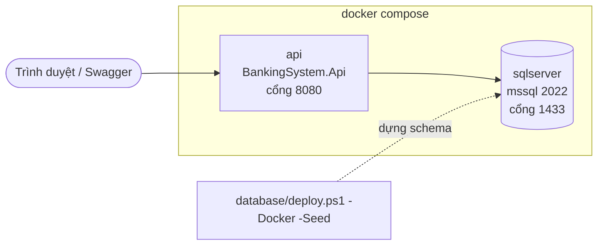

# System Design — Thiết kế hệ thống: Banking System

> **Loại tài liệu:** System Design Document (SDD), hay còn gọi là Technical Design Doc. Trả lời câu hỏi *hệ thống được xây thế nào và vì sao*.
> **Đọc trước:** [`SRS/01_SRS.md`](SRS/01_SRS.md) (hệ thống phải làm gì). **Đọc kèm:** [`api_contract.md`](api_contract.md) (định dạng dữ liệu, endpoint), [`pipeline.md`](pipeline.md) (luồng xử lý).

## Mục lục

- [1. Mục tiêu thiết kế](#1-mục-tiêu-thiết-kế)
- [2. Kiến trúc tổng thể](#2-kiến-trúc-tổng-thể)
- [3. Kiến trúc bên trong API](#3-kiến-trúc-bên-trong-api)
- [4. Cấu trúc thư mục](#4-cấu-trúc-thư-mục)
- [5. Bản đồ feature](#5-bản-đồ-feature)
- [6. Thiết kế dữ liệu](#6-thiết-kế-dữ-liệu)
- [7. Các vấn đề xuyên suốt](#7-các-vấn-đề-xuyên-suốt)
- [8. Quyết định thiết kế](#8-quyết-định-thiết-kế)
- [9. Triển khai](#9-triển-khai)
- [10. Giới hạn & hướng nâng cấp](#10-giới-hạn--hướng-nâng-cấp)

---

## 1. Mục tiêu thiết kế

| Mục tiêu | Nghĩa là |
|---|---|
| **Đúng tiền** | Không mất tiền, không âm số dư, kể cả khi nhiều request chạy song song |
| **Một nơi chứa quy tắc nghiệp vụ** | Quy tắc chỉ viết ở một chỗ (stored procedure), không chép sang C# |
| **Dễ đọc, dễ học** | Mỗi feature có cùng một hình dạng; sửa một nghiệp vụ chỉ mở một thư mục |
| **Vừa sức đồ án** | Một API, một database, chạy được bằng một lệnh. Không microservice, không message queue |

**Không nhắm tới:** tải lớn (> vài trăm người dùng đồng thời), multi-tenant, sẵn sàng cao nhiều vùng.

---

## 2. Kiến trúc tổng thể



| Thành phần | Trách nhiệm | Không làm |
|---|---|---|
| **React SPA** | Hiển thị, nhập liệu, kiểm tra form sơ bộ, giữ token | Không tính tiền, không tự quyết quyền |
| **API** | HTTP/JSON, xác thực (hash mật khẩu, JWT), phân quyền, kiểm tra quyền sở hữu, phân trang, gửi thông báo, job định kỳ, tính lịch trả góp | Không tự viết SQL thay đổi số dư; không lặp lại quy tắc của proc |
| **SQL Server** | Lưu dữ liệu, **toàn bộ quy tắc nghiệp vụ** trong 63 stored procedure, view đọc dữ liệu đã che, function kiểm tra | Không biết gì về HTTP, JWT, mật khẩu thô |

---

## 3. Kiến trúc bên trong API

Mỗi request đi qua cùng một chuỗi tầng:



| Tầng | Ở đâu | Được làm | Không được làm |
|---|---|---|---|
| Controller | `Features/<X>/XController.cs` | Map route → gọi service → trả `ApiResponse`; gắn `[Authorize]` | Chứa logic, gọi repository trực tiếp |
| Service | `Features/<X>/XService.cs` + `IXService.cs` | Kiểm tra quyền sở hữu, gọi service của feature khác qua interface, hash mật khẩu, phát token, gửi thông báo | Mở kết nối DB, viết SQL |
| Repository | `Features/<X>/XRepository.cs` | Gọi đúng một proc cho mỗi thao tác, map dòng → Domain object | Chứa quy tắc nghiệp vụ |
| Data | `Data/` | Mở kết nối, gọi proc theo tên tham số, đọc result set | Biết đến feature cụ thể |
| Domain | `Domain/` | Entity record và enum dùng chung giữa nhiều feature | Gọi DB, chứa logic hạ tầng |
| Common | `Common/` | Envelope, xử lý lỗi toàn cục, bảng mã lỗi, JSON converter, phân trang, đọc user hiện tại | Chứa nghiệp vụ của một feature |

**Quy tắc phụ thuộc:**
- Feature A cần dữ liệu của feature B → gọi `IBService`, **không** gọi `BRepository`. Ví dụ: `Transactions` hỏi `IAccountService` "tài khoản này có thuộc người đang đăng nhập không?".
- Chỉ `Data/` được `using Microsoft.Data.SqlClient`.
- Service có interface (để feature khác phụ thuộc vào hợp đồng, không phụ thuộc vào class cụ thể). Repository là class cụ thể, vì mỗi repository chỉ có một cách cài đặt và được kiểm thử bằng integration test với DB thật.

---

## 4. Cấu trúc thư mục

```
BankingSystem/
├── BankingSystem.sln
├── BankingSystem.Api/
│   ├── Features/                  một thư mục = một nghiệp vụ
│   │   ├── Auth/                  đăng ký, OTP, đăng nhập, JWT, mật khẩu, lịch sử đăng nhập
│   │   │   ├── AuthController.cs
│   │   │   ├── IAuthService.cs
│   │   │   ├── AuthService.cs
│   │   │   ├── AuthRepository.cs
│   │   │   └── Dtos/              LoginRequestDto, TokenResponseDto…
│   │   ├── Users/                 hồ sơ khách hàng + nhân viên
│   │   ├── Branches/              chi nhánh
│   │   ├── Accounts/              tài khoản ngân hàng (+ kiểm tra quyền sở hữu)
│   │   ├── Cards/                 thẻ
│   │   ├── Transactions/          nạp, rút, chuyển khoản, thanh toán, lịch sử, người thụ hưởng
│   │   ├── Loans/                 vòng đời khoản vay + lịch trả góp
│   │   ├── Savings/               sổ tiết kiệm + job đáo hạn
│   │   ├── Notifications/         thông báo
│   │   └── Admin/                 khoá/mở tài khoản, thống kê
│   ├── Domain/                    entity + enum dùng chung (Account, BankingAccount, Transaction…)
│   ├── Data/                      kết nối SQL Server, gọi stored procedure
│   ├── Common/                    envelope, xử lý lỗi, bảng mã lỗi, JSON, phân trang
│   ├── Program.cs                 đăng ký DI + middleware pipeline
│   ├── appsettings.json
│   └── Dockerfile
├── BankingSystem.Tests/           integration test (qua HTTP, DB thật) + unit test (logic thuần)
├── database/                      schema, stored procedure, view, seed, deploy.ps1
├── docs/                          tài liệu (bạn đang đọc)
├── docker-compose.yml
├── AGENTS.md                      quy tắc làm việc cho AI agent
├── PLAN.md                        lộ trình triển khai
└── README.md
```

**Khác với mẫu EF Core thường gặp:** `Data/` không có `AppDbContext` hay `Migrations`. Schema do `database/` quản lý và dựng bằng `deploy.ps1` (xem §8 ADR-01).

**Quy ước trong một feature:**

| File | Vai trò |
|---|---|
| `XController.cs` | Endpoint theo [`api_contract.md`](api_contract.md) §3 |
| `IXService.cs` / `XService.cs` | Hợp đồng và cài đặt nghiệp vụ |
| `XRepository.cs` | Một method ↔ một stored procedure |
| `Dtos/` | `XxxRequestDto` (input + kiểm tra hợp lệ), `XxxResponseDto` (output, camelCase) |
| File khác (khi cần) | Logic thuần riêng của feature, vd `Loans/AmortizationSchedule.cs`, `Savings/MaturitySettlementJob.cs` |

**Entity đặt ở đâu:** dùng từ 2 feature trở lên thì đặt ở `Domain/`, còn lại để trong feature.

---

## 5. Bản đồ feature

| Feature | Use case | Nhóm proc / view | Route gốc | Vai trò |
|---|---|---|---|---|
| Auth | UC-01, 02, 03, 23 | `sp_account_*`, `sp_otp_*`, `sp_login_history_*` | `/api/auth`, `/api/login-history` | Guest, mọi vai trò |
| Users | UC-04, 05, 06 | `sp_*customer*`, `sp_employee_*`, `sp_admin_create_employee_account` | `/api/customers`, `/api/employees` | Customer, Employee, Admin |
| Branches | UC-07 | `sp_branch_*` | `/api/branches` | Guest (xem), Admin |
| Accounts | UC-08, 09 | `sp_bank_account_*` | `/api/banking-accounts` | Customer, Employee |
| Cards | UC-15 | `sp_card_*` | `/api/cards` | Customer, Employee |
| Transactions | UC-10–14 | `sp_bank_transaction_*`, `sp_beneficiary_*` | `/api/transactions`, `/api/beneficiaries` | Customer, Teller |
| Loans | UC-16, 17, 18 | `sp_loan_*` | `/api/loans` | Customer, Loan Officer |
| Savings | UC-19, 20 | `sp_saving_account_*` | `/api/savings` | Customer, Scheduler |
| Notifications | UC-21 | `sp_notification_*` | `/api/notifications` | Customer, Employee |
| Admin | UC-22, 24 | `sp_admin_update_account_status`, `vw_CustomerStatistics`, `sp_branch_get_summary` | `/api/admin` | Admin |

Danh sách endpoint chi tiết: [`api_contract.md`](api_contract.md) §3.

---

## 6. Thiết kế dữ liệu

Chi tiết bảng và cột: [`schema.md`](schema.md). Sơ đồ quan hệ rút gọn:



| Nguyên tắc | Chi tiết |
|---|---|
| Tách đăng nhập và nghiệp vụ | `Account` chỉ chứa thông tin đăng nhập; hồ sơ nằm ở `Customer` / `Employee` |
| Ghi qua proc, đọc qua view | Mọi thay đổi đi qua `dbo.sp_*`; view `vw_*` trả dữ liệu đã che |
| Giá trị cố định qua bảng lookup | Trạng thái, loại, tiền tệ… là bảng lookup có khoá ngoại; giá trị chính xác ở [`api_contract.md`](api_contract.md) §1.5 |
| Schema dựng lại được | `pwsh -File database/deploy.ps1 -Seed` xoá và dựng lại DB từ đầu kèm dữ liệu mẫu |

---

## 7. Các vấn đề xuyên suốt

### 7.1 Bảo mật

| Vấn đề | Cách làm |
|---|---|
| Mật khẩu | Hash PBKDF2 ở API (`PasswordHasher`), proc chỉ lưu chuỗi hash. Đăng nhập: API lấy hash rồi tự so khớp |
| Phiên đăng nhập | JWT (claim: id tài khoản, username, vai trò), thời hạn 60 phút, không refresh token |
| Tài khoản bị khoá khi token còn hạn | Khi xác thực token, API kiểm tra trạng thái tài khoản; `Locked` / `Disabled` → `401` |
| Phân quyền | `[Authorize(Roles = …)]` theo vai trò; riêng việc duyệt vay kiểm tra thêm chức vụ `Loan Officer` |
| Quyền sở hữu | Mọi endpoint nhận id tài nguyên của khách hàng đều kiểm tra "có phải của người đang đăng nhập" (chống IDOR) |
| OTP | Không bao giờ trả về trong response; dev ghi log, production gửi email |
| Dữ liệu nhạy cảm | View đã che email / số điện thoại / CCCD / số tài khoản; API che thêm số thẻ |
| Secret | Connection string, JWT secret nằm trong `appsettings.Development.json` (gitignore) hoặc user-secrets / biến môi trường |

### 7.2 Xử lý lỗi



- Service và repository **không** try/catch lỗi nghiệp vụ. Lỗi proc tự thành response đúng định dạng nhờ handler toàn cục.
- Input sai (thiếu trường, sai độ dài) bị chặn ở controller → `400` cùng envelope, chưa chạm DB.
- Lỗi không lường trước → `500` cùng envelope, chi tiết chỉ ghi log.

### 7.3 Đồng thời (concurrency)

Mọi thay đổi số dư dùng **guarded update** trong proc: kiểm tra điều kiện và trừ tiền trong cùng một câu `UPDATE`; nếu `@@ROWCOUNT = 0` thì `THROW`. API không đọc số dư rồi mới trừ, không mở transaction riêng. Mỗi request gọi đúng một proc.

### 7.4 Tiền & thời gian

- Tiền: C# `decimal`, JSON là chuỗi `"1000000.00"`, làm tròn half-up 2 chữ số.
- Thời gian: giờ Việt Nam, JSON không kèm offset (`"2026-11-02T14:30:00"`); API không tự đổi múi giờ.

### 7.5 Logic tự tính ở API

Chỉ có đúng một chỗ: **lịch trả góp** (`Loans/AmortizationSchedule`), tính lúc gọi API theo công thức BR-10, không lưu bảng. Mọi tính toán khác (lãi tiết kiệm, phí, số dư) do proc làm.

### 7.6 Tác vụ nền

`Savings/MaturitySettlementJob`: một `BackgroundService` chạy mỗi ngày lúc 00:05 giờ Việt Nam, gọi `sp_saving_account_settle_matured`. Chạy chung tiến trình với API, không cần thư viện lập lịch.

### 7.7 Thông báo

Sau khi chuyển khoản / giải ngân thành công, service gọi `INotificationService`. Gửi thất bại → ghi log, **không** làm hỏng kết quả giao dịch (BR-13).

### 7.8 Phân trang

Proc tìm kiếm trả toàn bộ kết quả; API cắt trang trong bộ nhớ (`?page=0&size=20`), trả tổng số dòng qua header `X-Total-Count`. Khi một truy vấn vượt khoảng 5.000 dòng thì chuyển sang phân trang trong proc (`OFFSET … FETCH`).

### 7.9 Logging

Log có cấu trúc (`ILogger`) cho: đăng nhập, mọi giao dịch tiền (id, số tiền, kết quả), lỗi 5xx. **Không** log mật khẩu, token, số thẻ đầy đủ. Riêng mã OTP chỉ log ở môi trường dev.

---

## 8. Quyết định thiết kế

Ghi theo kiểu ADR rút gọn (Architecture Decision Record): quyết định gì, vì sao, đánh đổi gì.

| ID | Quyết định | Lý do | Đánh đổi |
|---|---|---|---|
| ADR-01 | Nghiệp vụ nằm trong **stored procedure**, không dùng EF Core / Migrations | 63 proc đã viết và kiểm thử, có chống race condition; viết lại bằng C# là hai bản quy tắc phải đồng bộ tay | Không có migration tự động; muốn đổi schema phải sửa `.sql` và chạy `deploy.ps1` |
| ADR-02 | Gọi proc bằng **ADO.NET**, không ORM / Dapper | Proc trả result set kèm cột `message`; đọc thô rồi map tay ngắn và dễ hiểu | Viết tay phần map dòng → object |
| ADR-03 | Chia thư mục **theo feature** | Sửa một nghiệp vụ chỉ mở một thư mục | Một số helper dùng chung phải đặt ở `Common/` |
| ADR-04 | **Interface cho Service**, class cụ thể cho Repository | Feature khác phụ thuộc vào hợp đồng; repository chỉ có một cài đặt và được test bằng DB thật | Service có thêm một file interface |
| ADR-05 | **JWT không trạng thái**, không refresh token | Đơn giản, đủ cho đồ án | Không thu hồi token ngay; bù lại bằng TTL 60 phút + kiểm tra trạng thái tài khoản khi xác thực |
| ADR-06 | Phân trang **trong bộ nhớ** | Proc tìm kiếm chưa hỗ trợ phân trang; dữ liệu đồ án nhỏ | Phải đổi khi dữ liệu lớn (§7.8) |
| ADR-07 | Job nền bằng **`BackgroundService`** | Có sẵn trong ASP.NET Core, không cần Quartz hay tiến trình riêng | Chạy nhiều instance API thì job chạy trùng (proc idempotent nên chấp nhận được) |
| ADR-08 | Tiền là **chuỗi** trong JSON | JavaScript `number` làm sai số tiền | Frontend phải parse chuỗi |

---

## 9. Triển khai



| Môi trường | Database | Cách chạy |
|---|---|---|
| Dev trên máy | SQL Server Express `localhost\SQLEXPRESS01` (Windows Auth) | `deploy.ps1 -Seed` rồi `dotnet run` |
| Docker | Container `sqlserver` trong `docker-compose.yml` | `docker compose up`, rồi `deploy.ps1 -Docker -Seed` |
| CI | SQL Server service container | Xem [`pipeline.md`](pipeline.md) §4 |

Cấu hình qua `appsettings.json` + biến môi trường (`ConnectionStrings__BankingSystem`, `Jwt__Secret`).

---

## 10. Giới hạn & hướng nâng cấp

| Giới hạn hiện tại | Khi nào nâng cấp | Hướng nâng cấp |
|---|---|---|
| Phân trang trong bộ nhớ | Truy vấn > 5.000 dòng | Thêm `@offset/@fetch` vào proc tìm kiếm |
| Không thu hồi được JWT | Cần đăng xuất tức thì | Refresh token + danh sách token bị thu hồi |
| Đếm đăng nhập sai chưa có | M5 | Bộ đếm theo tài khoản, khoá tạm sau 5 lần / 15 phút |
| Chuyển khoản chưa xác nhận lại bằng OTP | Trước khi coi là "production" | OTP mục đích `Transaction` + cột `consumed` |
| Job nền chạy trong API | Chạy nhiều instance | Tách worker hoặc dùng khoá phân tán |
